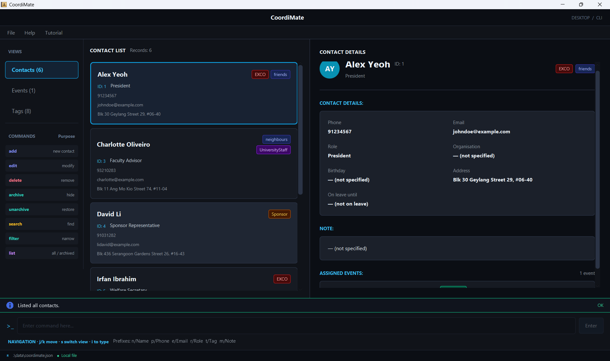
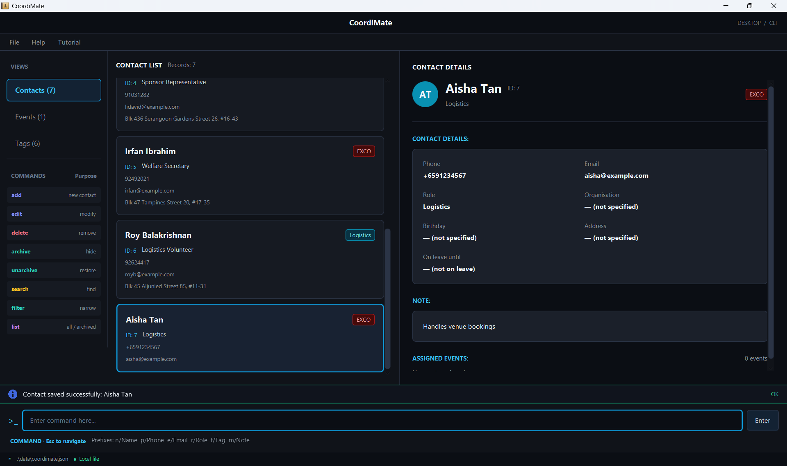
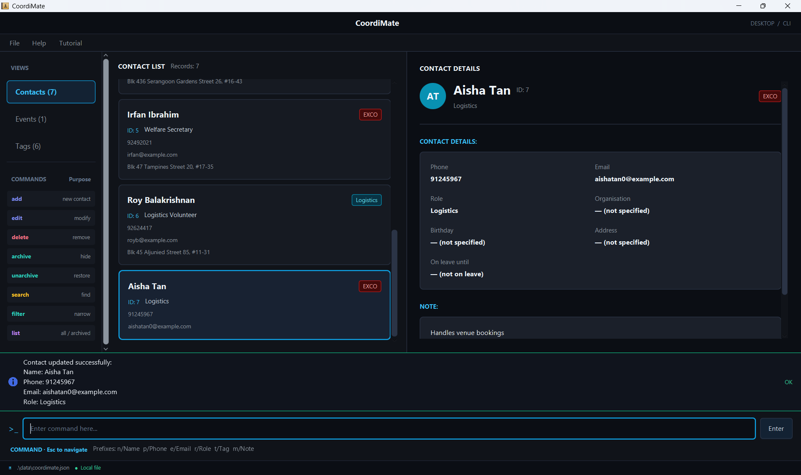
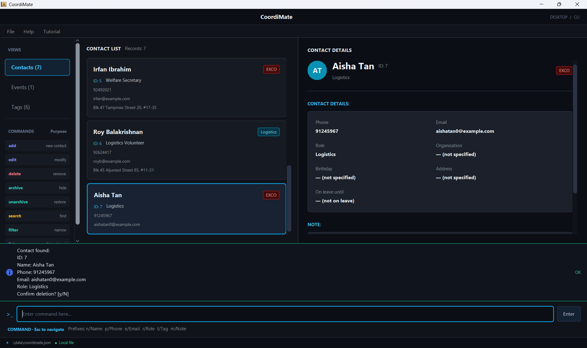
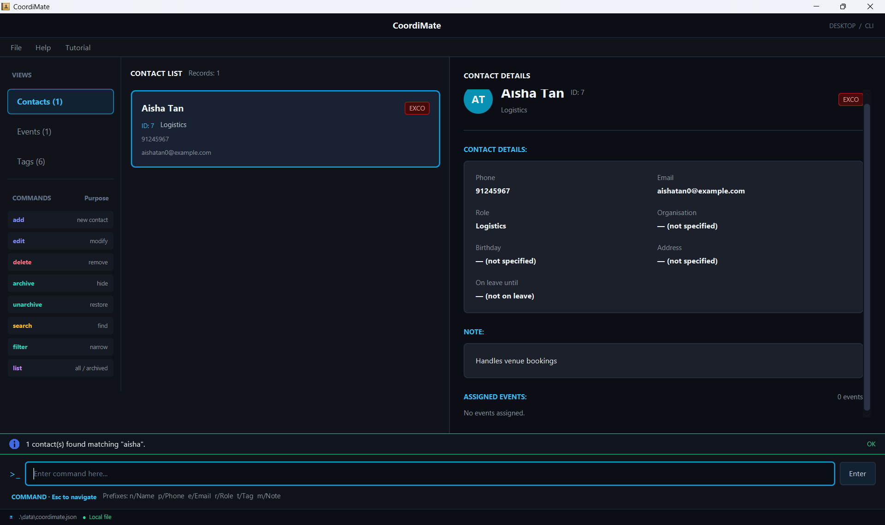
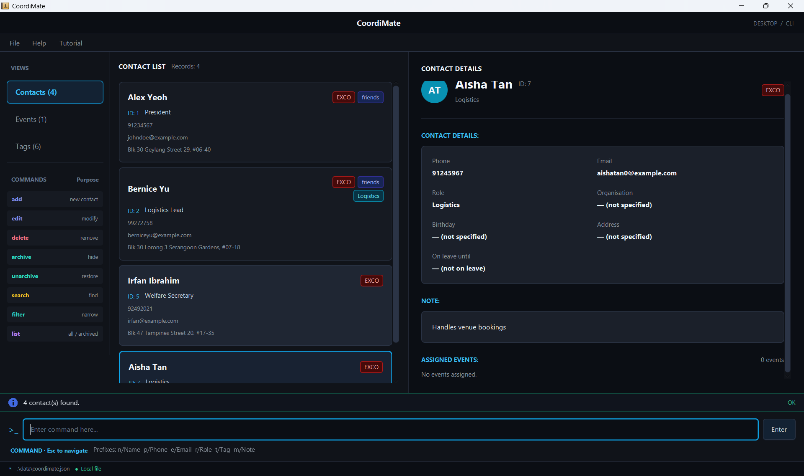
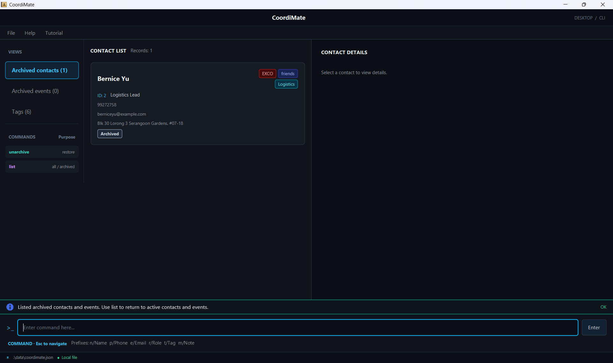
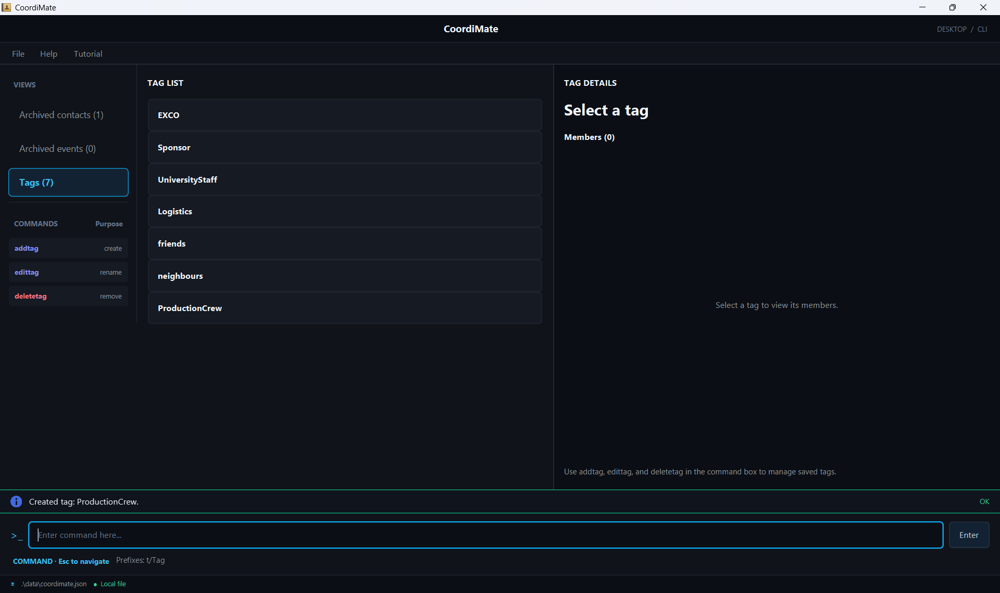

# CoordiMate User Guide

**CoordiMate** is a desktop application that helps university CCA EXCO members organise committee information and coordinate their work. It lets users manage contacts and tags, plan events, assign members, and track attendance through a Command Line Interface (CLI) while retaining the benefits of a Graphical User Interface (GUI).

<!-- * Table of Contents -->
<page-nav-print />

--------------------------------------------------------------------------------------------------------------------

## Quick start

1. Ensure that Java `25` or later is installed on your computer.<br>
   **Mac users:** Ensure you have the precise JDK version prescribed [here](https://se-education.org/guides/tutorials/javaInstallationMac.html).

1. Download the latest `.jar` file from [here](https://github.com/AY2627S1-CS2103T-W12-3/tp/releases).

1. Copy the file to the folder you want to use as the _home folder_ for CoordiMate.

1. Open a terminal, `cd` to the folder containing the JAR file, and run `java -jar coordimate.jar`.<br>
   On the first launch, a maximized GUI similar to the one below should appear in a few seconds, together with a
   short tutorial. Note how the app contains some sample data.<br>
   

1. Type a command in the command box and press Enter to execute it. For example, type **`help`** and press Enter to
   open the help window.<br>
   Some example commands you can try:

   * `list` : Lists all contacts and events.

   * `add n/John Doe p/98765432 e/johnd@example.com r/Member` : Adds a contact named `John Doe` to CoordiMate.

   * `delete 3` : Asks to delete the contact with member ID `3`. Type `y` and press Enter to confirm.

   * `clear` : Deletes all contacts, events, and custom tags, and restores the default tags.

   * `exit` : Exits the app.

1. Read [The main window](#the-main-window) for a tour of the screen, and [Features](#features) for details of each
   command.

--------------------------------------------------------------------------------------------------------------------

## The main window

* **Top bar:** **File** > **Exit** closes CoordiMate. **Help** (<kbd>Fn</kbd> + <kbd>F1</kbd>) opens the help window,
  and **Tutorial** (<kbd>Fn</kbd> + <kbd>F2</kbd>) restarts the tutorial.
* **Upcoming events panel:** appears below the top bar when an event is about to start. See
  [Automatic event reminders](#automatic-event-reminders).
* **Sidebar:** switches between the **Contacts**, **Events**, and **Tags** views, and shows how many items each has.
  Below the views, it lists the commands for the selected view. Click a command name to put the command word in the
  command box and show its format and an example below the box, then type its arguments.
* **List and details:** each view shows a list beside the details of the selected item.
  * **Contacts:** the details show the contact's phone number, email address, role, birthday, address, organisation,
    tags, note, leave, and assigned events. Unset optional fields show `— (not specified)`. If a list change hides
    or removes the selected contact, the details pane clears.
  * **Events:** each event card shows its member count and attendance summary. The details show the start time, end
    time, duration, and members. Each member row shows the contact's role, organisation, tags, notes, current leave
    status, and attendance status.
  * **Tags:** the details show the contacts that have the selected tag. See [Viewing all tags](#viewing-all-tags).

  At narrower window sizes, the list appears above the details. The divider between them can be dragged, but the
  details pane keeps a minimum width while the panes are side by side.
* **Command box and feedback:** type a command and press Enter, or click **Enter**. The result appears in the
  feedback area above the box; scroll it to read a long message. A rejected command shows a red feedback band and
  input border, and stays in the box so you can correct it, then press Enter or click **Retry**. Below the box,
  CoordiMate shows the current [keyboard mode](#navigating-cards-with-the-keyboard) and the prefixes you can use.
* **Bottom bar:** shows where your data file is saved.

**Member IDs:** contact cards and details, event rosters, and tag member lists show each contact's permanent
identifier as `ID: <number>`. Use that ID in `edit`, `delete`, `archive`, `unarchive`, `assign`, and `unassign`. It
does not change when you edit the contact or when a search or filter reorders the list, so `ID: 12` stays `ID: 12`
even when a search makes that contact the first result.

**Which view opens after a command:** contact commands open **Contacts**, event commands open **Events**, and tag
commands open **Tags**. `assign` and `unassign` keep the current view and refresh its details. A failed command keeps
the current view. Successful `add` and `edit` commands select and reveal the affected contact. After a confirmed
deletion, the contact now at the removed contact's position is selected, or the previous contact if the removed
contact was last.

**Window size and position:** CoordiMate remembers whether the window was maximized, and its last size and position.
If those no longer fit your display, for example after disconnecting a second screen, it adjusts the window to stay
fully visible. On displays large enough, the minimum window size is 1200 × 800. On smaller displays, CoordiMate fits
the available screen.

--------------------------------------------------------------------------------------------------------------------

## Features

Every command error is followed by the relevant command's description, `Parameters:`, and `Example:`.
Error messages shown below omit that usage text.
Conditions in the error tables assume the rest of the command is valid. If a command has several errors,
the first one encountered during validation is reported. Placeholders such as `{PREFIX}` and `{EVENT_NAME}`
are replaced with the actual parameter prefix, name, member ID, or other details.

| Condition | Error message |
|---|---|
| The input is empty or contains only whitespace. | `Invalid command format.` |
| The command word is unknown or uses the wrong capitalization. | `Unknown command. Use help to see the available commands. Example: help` |
| Existing data cannot be loaded before a command changes saved data. | `Saved data could not be loaded. Check the local data file.` |

For `dismiss`, data-loading and saving failures instead produce the session-only warning described in
[Dismissing a reminder](#dismissing-a-reminder-dismiss).

<box type="info" seamless>

**Notes about the command format:**<br>

* Words in `UPPER_CASE` are the parameters to be supplied by the user.<br>
  For example, in `add n/NAME`, replace `NAME` with a value such as `John Doe`.

* Items in square brackets are optional.<br>
  For example, `n/NAME [t/TAG]` can be used as `n/John Doe t/friend` or as `n/John Doe`.

* Items followed by `...` are repeatable and can appear zero or more times.<br>
  For example, `[t/TAG]...` may be omitted, or written as `t/friend` or `t/friend t/family`.

* Parameters can be in any order.<br>
  For example, if the command specifies `n/NAME p/PHONE_NUMBER`, `p/PHONE_NUMBER n/NAME` is also acceptable.

* Commands that take no parameters, such as `help`, `tutorial`, `exit`, and `clear`, reject extraneous
  parameters.<br>
  For example, `help 123` is invalid; use `help` instead.

* If you are using a PDF version of this document, be careful when copying and pasting commands that span multiple lines as space characters surrounding line-breaks may be omitted when copied over to the application.
</box>

### Parameter constraints

The table below lists the values each parameter accepts. Leading and trailing spaces are ignored for every parameter.
In contact names and event names, several spaces in a row are saved as one space, so `Alex  Yeoh` is saved and
matched as `Alex Yeoh`.
Contact names accept only ordinary spaces internally. Event names also accept Unicode space separators,
including em, thin, ideographic, and non-breaking spaces; these are saved and matched as ordinary spaces.
A command that breaks a constraint is rejected and makes no changes.

| Parameter | Prefix | Constraints |
|---|---|---|
| `NAME`, `MEMBER_NAME` | `n/`, `mem/` | 1 to 80 characters. Letters, spaces, hyphens (`-`), apostrophes (`'`), and periods (`.`) only, with at least one letter. The words `s/o` and `d/o` (any capitalization) are also allowed, e.g. `Rajesh s/o Kumar`. Digits are not allowed. Several spaces in a row count as one. Contact names are unique, ignoring case and extra spaces. |
| `PHONE` | `p/` | 7 to 15 digits. May start with `+` or a bracketed country code such as `(+65)`, and may contain spaces, hyphens, and brackets. Brackets must come in pairs that each enclose at least one digit, and cannot be nested. Unique among contacts once spaces, hyphens, and brackets are removed. |
| `EMAIL` | `e/` | `local-part@domain`, at most 254 characters, with a local part of at most 64 characters. The local part uses letters, digits, and `_`, `%`, `+`, `-`, `.`; it cannot start or end with a period or contain two periods in a row. The domain is made of labels separated by periods; each label uses letters, digits, and hyphens and cannot start or end with a hyphen. The last label has at least 2 letters. Unique among contacts, ignoring case. |
| `ROLE` | `r/` | 1 to 50 characters. Letters, digits, spaces, hyphens, and `/` only, with at least one letter or digit. |
| `BIRTHDAY` | `b/` | A real date in `dd-MM-yyyy` format that is not in the future, e.g. `18-06-2004`. |
| `LEAVE_END_DATE` | `lv/` | A real date in `dd-MM-yyyy` format that is not in the past, e.g. `30-11-2026`. Today's date is allowed. |
| `ADDRESS` | `a/` | 1 to 200 printable characters, including at least one visible character. |
| `ORGANISATION` | `o/` | 1 to 80 characters. Letters, digits, spaces, and `-` `&` `.` `,` `'` `(` `)` `/` only, with at least one letter or digit. Several spaces in a row count as one. |
| `NOTE` | `m/` | 1 to 500 printable characters, including at least one visible character. |
| `TAG`, `NEW_TAG` | `t/`, `at/`, `rt/` | 1 to 30 characters. English letters and digits only, with no spaces. Tags are unique, ignoring case. A contact can have at most 15 tags. |
| `EVENT_NAME`, `NEW_EVENT_NAME` | `evn/`, `nevn/` | 1 to 100 printable Unicode characters, including at least one visible character. Internal tabs, line breaks, and control characters are rejected. Several spaces in a row count as one. Event names are unique, ignoring case and extra spaces. See the parameter syntax note below. |
| `START_TIME`, `END_TIME` | `st/`, `et/` | A real date in `dd-MM-yyyy` format, optionally followed by a 24-hour time in `HH:mm` format, e.g. `17-09-2026` or `17-09-2026 16:30`. The start must not be after the end. |
| `STATUS` | `att/` | `present` or `absent`, ignoring case. |
| `MEMBER_ID` | `c/` for `assign` and `unassign`; none for `edit`, `delete`, `archive`, and `unarchive` | A permanent positive integer from 1 to 2147483647 identifying a saved contact, independent of the displayed list. |
| `KEYWORD` | none | At least one non-space character. |

"Printable" excludes line breaks and other control characters. "Visible" excludes spaces, zero-width and formatting characters, accent marks on their own, and blank filler characters such as `U+3164` Hangul Filler.

<box type="info" seamless>

**Note:** In commands that accept multiple prefixed parameters, such as `add` and `addevent`, text within
a value that looks like another parameter—a space followed by letters and `/`—is read as the start of
another parameter. Unicode whitespace, including em and non-breaking spaces, uses the same parameter boundaries
as ordinary spaces. It cannot be used to hide a parameter inside an event name.
For example, `addevent evn/Planning tag/review ...` is rejected with an unknown-parameter error, and in
`m/Check a/v setup` the text after `a/` is read as the address. Write such text without the space before it,
or without the `/`, e.g. `m/Check AV setup`. The exception is `s/o` and `d/o` followed by a space or the end of the
input, which are read as part of a name, e.g. `n/Rajesh s/o Kumar`.

Commands parse their arguments differently. For example, `search` treats the entire remainder as its keyword,
while tag commands tokenize only their recognised `t/` prefix.
</box>

--------------------------------------------------------------------------------------------------------------------

## General commands

### Viewing help: `help`

Opens a resizable Help window containing a keyboard-navigation summary and a scrollable two-column table of every
available command and its usage format.
The [User Guide website](https://ay2627s1-cs2103t-w12-3.github.io/tp/) and **Copy URL** button remain at the bottom of
the window for access to detailed instructions.
Select **Close** or press <kbd>Esc</kbd> to dismiss the Help window without exiting CoordiMate.
Selecting **Help** in the top bar opens this window directly. Press <kbd>Fn</kbd> + <kbd>F1</kbd> to open it with the
keyboard. In the command formats, parameters enclosed in square brackets `[ ]` are optional.

Format: `help`

### Taking the tutorial: `tutorial`

The first time CoordiMate starts, a guided overlay opens automatically. Use **← Back** and **Next →** or press the
Left and Right Arrow keys to move through the sixteen steps. Press <kbd>Tab</kbd> or <kbd>Shift</kbd> + <kbd>Tab</kbd> to
move between the tutorial's buttons. Select **Close (Esc)** or press <kbd>Esc</kbd> to leave the tutorial. On the last step, **Finish →** or the Right Arrow key completes it. The tour introduces
the Contacts, Events, and Tags views; their lists and details; the command box; keyboard navigation; and Help. It
selects each view as it is introduced and leaves the current view selected when you close it. The highlighted area
stays bright while the rest of the app is dimmed. The app cannot be used to enter commands during the tour.

To take the tutorial again, enter `tutorial`, select **Tutorial** beside **Help** in the top bar, or press
<kbd>Fn</kbd> + <kbd>F2</kbd>. The tutorial always starts again from its first step.

Format: `tutorial`

### Listing contacts and events: `list`

Shows all active contacts and events, removing any search, filter, or members view. `list archived` instead shows
only [archived](#archiving-contacts-archive-unarchive) contacts and events.

Format: `list [archived]`

* `list` shows the contacts and events that are not archived. This is the normal view.
* `list archived` shows only archived contacts in the **Contacts** tab and only archived events in the **Events** tab.
  The tabs and the event list heading read **Archived contacts** and **Archived events** while this view is open, and
  an empty list shows `No archived contacts.` or `No archived events.` `archived` may be written in any capitalization.
* Both forms open the **Contacts** tab.
* In the archived view, the left sidebar lists only `unarchive` (or `unarchiveevent` in the **Events** tab) and `list`.
  Other commands still work: `search`, `filter`, and `members` look only at archived contacts, and `edit`, `delete`,
  `editevent`, `deleteevent`, and `markattendance` work on archived items. Unarchived items leave the view immediately.
* `add` and `addevent` return to the normal view, so that the new contact or event is visible. Opening the
  tutorial also returns to the normal view, since it walks through the normal lists and commands.

Examples:

* `list` returns to the normal view.
* `list archived` shows the archived contacts and their member IDs. `unarchive 12` then restores the contact with member ID `12`.

Success: `Listed all contacts.` or `Listed archived contacts and events. Use list to return to active contacts and events.`

| Condition | Error message |
|---|---|
| Anything other than `archived` follows `list`. | `Unknown list option: {OPTION}. Use list, or list archived to show archived contacts and events.` |

### Clearing all entries: `clear`

Deletes all contacts, events, and custom tags from CoordiMate. The default tags (`EXCO`, `Sponsor`,
`UniversityStaff`, and `Logistics`) are restored, including any that were renamed or deleted.

Format: `clear`

Success: `CoordiMate has been cleared!`

<box type="warning" seamless>

**Caution:** `clear` takes effect immediately, without asking for confirmation, and cannot be undone.
</box>

The cleared data is saved before the contact, event, and tag lists change. If the local data file cannot be read,
CoordiMate reports `Saved data could not be loaded. Check the local data file.` If saving fails, it reports
`CoordiMate could not be cleared. No changes were made.` In either case, the displayed data remains unchanged.

### Exiting the program: `exit`

Closes CoordiMate. Your data is already saved, so nothing is lost.

Format: `exit`

### Navigating cards with the keyboard

CoordiMate starts in **Command mode**, with the command box ready for input. The mode indicator below the command box
shows the current mode and its available shortcuts.


*The mode indicator below the command box, showing Navigation mode and its shortcuts.*

Use the following keys to browse Contacts, Events, or Tags without the mouse:

| Key | Result |
|---|---|
| <kbd>Esc</kbd> | Enter **Navigation mode** from Command mode. |
| <kbd>J</kbd> | Select the next card in the active view. If nothing is selected, select the first card. |
| <kbd>K</kbd> | Select the previous card in the active view. If nothing is selected, select the last card. |
| <kbd>S</kbd> | Switch to the next view, wrapping from Tags back to Contacts. |
| <kbd>I</kbd> | Return to **Command mode** and focus the command box. |

Navigation stops at the first or last card rather than wrapping around. On an empty list, <kbd>J</kbd> and <kbd>K</kbd>
do nothing. The shortcuts apply to whichever of the Contacts, Events, or Tags views is active. Each view keeps its
selection when you switch away and back.

Other unmodified keys, including <kbd>Enter</kbd>, <kbd>Space</kbd>, <kbd>Tab</kbd>, and the arrow keys, are disabled
in Navigation mode. Pressing <kbd>Esc</kbd> moves keyboard focus away from controls such as a reminder's
**Dismiss** button, so those controls cannot be activated accidentally. Mouse controls remain available.

You can chain navigation and command entry without clicking. For example, press <kbd>Esc</kbd>, <kbd>J</kbd>,
<kbd>J</kbd>, <kbd>I</kbd>, then type a command. Any unfinished command remains in the command box while you navigate.

Clicking the command box or choosing a command from the left sidebar enters Command mode. Clicking the contact,
event, or tag list enters Navigation mode. Mode switching is disabled while CoordiMate is waiting for confirmation
of a delete command, so your confirmation input is not intercepted.

### Reusing commands with command history

With the command box focused, press <kbd>Up</kbd> to recall the most recently entered command. Keep pressing
<kbd>Up</kbd> to move through older commands, or press <kbd>Down</kbd> to move forward. Moving past the newest
command restores any unfinished text that was in the box before you started browsing. You can edit a recalled
command; it runs only when you press Enter or select **Enter**.

History includes commands that produced errors, so you can correct and retry them. There is no fixed maximum number
of entries; the practical limit is the memory available to the app. History clears when you close CoordiMate.
Blank inputs and responses to a delete confirmation are not stored. History navigation is paused while CoordiMate
is waiting for a delete confirmation.

--------------------------------------------------------------------------------------------------------------------

## Managing contacts

### Adding a contact: `add`

Adds a contact to CoordiMate.

Contact names must be unique, ignoring case and extra spaces. Surrounding spaces are removed and several spaces in a
row are saved as one, so `n/Alex  Yeoh` is saved as `Alex Yeoh` and is a duplicate of an existing `Alex Yeoh`.
An add is also rejected if its phone number or email address is already used by another contact.
Phone numbers are compared without spaces, hyphens, or brackets; email addresses are compared without regard to case.
For any duplicate, CoordiMate reports `A contact with this name, phone number, or email already exists.`
and makes no changes.
If the local contact data cannot be loaded or saved, CoordiMate reports an error and leaves the contact list unchanged.

Format: `add n/NAME p/PHONE e/EMAIL r/ROLE [b/BIRTHDAY] [a/ADDRESS] [o/ORGANISATION] [lv/LEAVE_END_DATE] [t/TAG]... [m/NOTE]`

* Name, phone, email, and role are required; birthday, address, organisation, leave end date, and note are optional. Surrounding spaces are ignored. Each field follows the constraints in [Parameter constraints](#parameter-constraints).
* A value that breaks a constraint is rejected with a message stating that field's constraint, such as `Invalid organisation. Use 1 to 80 characters: letters, digits, spaces, and - & . , ' ( ) /, with at least one letter or digit. Example: o/NUS Student Affairs`.
* An empty `b/`, `a/`, `o/`, `lv/`, or `m/` leaves that field unset, as does omitting it.
* Non-tag fields may appear only once; `t/TAG` may repeat. An empty `t/` clears the tags collected so far.
* A tag that matches a saved tag, ignoring capitalization, uses the saved tag's capitalization; for example, `t/exco` gives the contact the default `EXCO` tag. A valid new tag keeps its typed capitalization and is saved as a custom tag.
* Successful feedback is `Contact saved successfully: NAME`. After a successful `add`, CoordiMate selects and reveals the new contact so its details are shown. Unset optional values are shown as `— (not specified)` in the details pane, but remain unset in storage.

<box type="tip" seamless>

**Tip:** A contact can have up to 15 tags, including zero. Tags that differ only in capitalization count as one. Parameters can be supplied in any order.
</box>


*Aisha Tan's contact card and details pane, shown automatically after `add` saves her.*

Examples:
* `add n/Aisha Tan p/+6591234567 e/aisha@example.com r/Logistics t/EXCO m/Handles venue bookings`
* `add n/Mr Lim p/90801110 e/lim@example.com o/NUS Student Affairs r/University Staff t/UniversityStaff`
* `add n/Rajesh s/o Kumar p/90000001 e/rajesh@example.com r/Member` adds a contact whose name includes `s/o`.
* `add n/Ben Ong p/91112222 e/ben@example.com r/Publicity lv/30-11-2026` adds a contact who is on leave until
  30 November 2026. See [Marking a contact as on leave](#marking-a-contact-as-on-leave).

| Condition | Error message |
|---|---|
| Any required prefix (`n/`, `p/`, `e/`, or `r/`) is missing, or there is text before the first parameter. | `Invalid command format.` |
| A non-tag parameter is repeated. | `Parameter {PREFIX} may only be specified once.` |
| An unknown parameter is used. | `Unknown parameter: {PREFIX}.` |
| The name is empty or contains only whitespace. | `Name must not be empty. Example: n/Aisha Tan` |
| The phone number is empty or contains only whitespace. | `Phone number must not be empty. Example: p/+6591234567` |
| The email is empty or contains only whitespace. | `Email must not be empty. Example: e/aish@example.com` |
| The role is empty or contains only whitespace. | `Role must not be empty. Example: r/Logistics Lead` |
| The name violates its constraints. | `Invalid name. Use 1 to 80 characters: letters, spaces, hyphens, apostrophes, periods, and s/o or d/o, with at least one letter. Example: n/Aisha Tan` |
| The phone number violates its constraints. | `Invalid phone number. Use 7 to 15 digits, optionally starting with + or (+country code), with optional spaces, hyphens, and matching brackets around digits. Example: p/+6591234567` |
| The email violates its constraints. | `Invalid email. Use local-part@domain, at most 254 characters, with a local part of at most 64 characters. Example: e/aish@example.com` |
| The role violates its constraints. | `Invalid role. Use 1 to 50 characters: letters, digits, spaces, hyphens, and slashes, with at least one letter or digit. Example: r/Logistics Lead` |
| A non-empty birthday is invalid, incorrectly formatted, or in the future. | `Invalid birthday. Use a real date in dd-MM-yyyy format that is not in the future. Example: b/18-06-2004` |
| A non-empty leave end date is invalid, incorrectly formatted, or in the past. | `Invalid leave end date. Use a real date in dd-MM-yyyy format that is not in the past. Example: lv/30-11-2026` |
| A non-empty address exceeds 200 characters, has no visible characters, or contains a control character. | `Invalid address. Use 1 to 200 printable characters. Example: a/21 Kent Ridge Road, #03-12` |
| A non-empty organisation violates its constraints. | `Invalid organisation. Use 1 to 80 characters: letters, digits, spaces, and - & . , ' ( ) /, with at least one letter or digit. Example: o/NUS Student Affairs` |
| A non-empty note exceeds 500 characters, has no visible characters, or contains a control character. | `Invalid note. Use 1 to 500 printable characters. Example: m/Handles venue bookings` |
| A non-empty tag contains spaces, symbols, or punctuation. | `Invalid tag name. Use letters and numbers without spaces. Example: t/Publicity` |
| A tag exceeds 30 characters. | `Tag name must not exceed 30 characters. Example: t/Publicity` |
| More than 15 different tags are supplied, ignoring case. | `A contact can have at most 15 tags.` |
| Another contact has the same name, phone number, or email. | `A contact with this name, phone number, or email already exists.` |

If saving fails, the command reports `Contact could not be saved. No changes were made.`

### Editing a contact: `edit`

Edits an existing contact in CoordiMate.

Format: `edit MEMBER_ID [n/NAME] [p/PHONE] [e/EMAIL] [r/ROLE] [b/BIRTHDAY] [a/ADDRESS] [o/ORGANISATION] [m/NOTE] [lv/LEAVE_END_DATE] [t/TAG]... [at/TAG]... [rt/TAG]...`

Or: `edit target/IDENTIFIER [n/NAME] [p/PHONE] [e/EMAIL] [r/ROLE] [b/BIRTHDAY] [a/ADDRESS] [o/ORGANISATION] [m/NOTE] [lv/LEAVE_END_DATE] [t/TAG]... [at/TAG]... [rt/TAG]...`

* Edits the contact with the specified permanent `MEMBER_ID`, including contacts hidden by a search or filter.
  For example, `edit 12 r/President` always targets member ID `12`, even when that contact is the first search result.
* Alternatively, `target/IDENTIFIER` finds an exact saved name, phone number, or email address across all contacts, including those hidden by the current search or filter. Names ignore letter case and extra spaces, emails ignore letter case; phone numbers ignore spaces, hyphens, and brackets. Supply either a member ID or `target/`, not both.
* If several contacts match an identifier, the command lists each match's member ID, name, phone, and email, including hidden matches. Retry with a member ID, unique phone number, or email address.
* If no contact matches `target/`, or the member ID does not exist, the command reports an error without changing any contact.
* Provide at least one field or tag operation. Omitted fields retain their existing values.
* Name, phone, email, and role cannot be cleared. Use `b/`, `a/`, `o/`, `lv/`, or `m/` with no value to clear that optional field.
* Birthday uses `dd-MM-yyyy` and cannot be in the future. Edited values follow the same validation rules as `add`.
* Older saved digit-only phone numbers with at least 3 digits, and older saved numbers with unmatched brackets,
  remain usable. An edit without `p/` keeps the existing number; a supplied `p/` value must follow the current rule.
* Each non-tag field may be specified only once. Unknown parameters are rejected.
* `t/TAG` replaces all existing tags; repeat it to specify several replacement tags. `t/` with no value clears the tag set.
* `at/TAG` adds a tag without removing other tags, while `rt/TAG` removes only that tag from the contact. These may be repeated or mixed and are applied in command order. Neither may be mixed with `t/`.
* Tag matching ignores case. Adding an existing tag or removing an absent tag has no effect. A valid new tag named by `t/` or `at/` is saved as a custom tag. Empty `at/` and `rt/` values are invalid.
* `t/` replacements may contain at most 15 tags, and `at/` cannot give a contact more than 15 tags. A contact saved with more than 15 tags can still be edited with `at/` and `rt/`, or without changing its tags, as long as the edit does not increase its number of tags.
* If the contact's name changes, events they are assigned to show the new name.
* A new name already used by another contact, ignoring case and extra spaces, is rejected.
* An edit is saved to the local data file before it appears in the contact list. If the file cannot be read or written,
  the edit is not applied. A failed write reports `Contact could not be saved. No changes were made.`; invalid stored
  data reports `Saved data could not be loaded. Check the local data file.`
* On success, `edit` confirms the updated name, phone, email, and role. The selected contact's details pane shows its
  current optional fields and tags.

Successful feedback example:

```text
Contact updated successfully:
Name: Aisha Tan
Phone: +6598765432
Email: aisha@example.com
Role: President
```


*The same contact's details pane after `edit` updates their phone number and email address.*

Examples:
*  `edit 1 p/91234567 e/johndoe@example.com` Edits the phone number and email address of member ID `1` to be `91234567` and `johndoe@example.com` respectively.
*  `edit 2 n/Betsy Crower t/` Edits the name of member ID `2` to be `Betsy Crower` and clears all existing tags.
*  `edit 3 r/Logistics Lead m/Handles venue bookings` Updates a role and note.
*  `edit 3 b/ a/ o/ m/` Clears the optional birthday, address, organisation, and note.
*  `edit target/alice@example.com r/Vice-President` Updates a contact even if the current list is filtered.
*  `edit 3 at/Sponsor rt/Logistics` Adds Sponsor, then removes Logistics without changing other tags.
*  `edit 2 lv/30-11-2026` Marks the contact with member ID `2` as on leave until 30 November 2026, and `edit 2 lv/` ends their leave.

Edited contact fields use the same validation error messages as [`add`](#adding-a-contact-add).
Empty optional fields (`b/`, `a/`, `o/`, `lv/`, `m/`, and `t/`) clear those values and are accepted.
Additional errors are listed below.

| Condition | Error message |
|---|---|
| No arguments are supplied. | `Invalid command format.` |
| `target/` is omitted and the member ID is missing, is not a positive integer, or exceeds the supported integer range. | `Invalid member ID. Example: edit 12 r/President` |
| The member ID does not exist. | `No contact exists with member ID: {MEMBER_ID}. Use an existing member ID.` |
| Text or a member ID appears before `target/`. | `Specify exactly one contact identifier.` |
| `target/` is empty or contains only whitespace. | `Contact identifier must not be empty. Example: target/aisha@example.com` |
| No saved contact matches `target/`. | `No contact matches that identifier. Use an exact saved name, phone number, or email address.` |
| Several contacts match `target/`. | `Multiple contacts match that identifier:`<br>matching contact details with `ID: <number>`<br>`Use a member ID, phone number, or email address to identify the contact.` |
| A valid identifier is supplied without any fields or tag operations to edit. | `Provide at least one field or tag operation to edit.` |
| A parameter other than `t/`, `at/`, or `rt/` is repeated. | `Parameter {PREFIX} may only be specified once.` |
| An unknown parameter is used. | `Unknown parameter: {PREFIX}.` |
| `t/` is combined with `at/` or `rt/`. | `Use either t/ to replace tags, or at/ and rt/ to add or remove them.` |
| `at/` is empty or contains only whitespace. | `Tag name must not be empty. Example: at/Publicity` |
| `rt/` is empty or contains only whitespace. | `Tag name must not be empty. Example: rt/Publicity` |
| An `at/` tag contains spaces, symbols, or punctuation. | `Invalid tag name. Use letters and numbers without spaces. Example: at/Publicity` |
| An `rt/` tag contains spaces, symbols, or punctuation. | `Invalid tag name. Use letters and numbers without spaces. Example: rt/Publicity` |
| An `at/` tag exceeds 30 characters. | `Tag name must not exceed 30 characters. Example: at/Publicity` |
| An `rt/` tag exceeds 30 characters. | `Tag name must not exceed 30 characters. Example: rt/Publicity` |
| `t/` supplies more than 15 different tags, or `at/` would give the contact more than 15 tags. | `A contact can have at most 15 tags.` |
| The updated name, phone number, or email conflicts with another saved contact. | `This update conflicts with another saved contact. No changes were made.` |
| Renaming the contact would duplicate a member name in an event. | `Cannot rename this contact because an event already has a member with that name. No changes were made.` |

### Marking a contact as on leave

Records that a contact is temporarily unavailable until a given date, so you do not need to remember to clear it
afterwards. Leave is an optional contact field, set with `lv/` in [`add`](#adding-a-contact-add) or
[`edit`](#editing-a-contact-edit).

Format: `edit MEMBER_ID lv/LEAVE_END_DATE` or `edit target/IDENTIFIER lv/LEAVE_END_DATE`

* `LEAVE_END_DATE` is the **last day** of leave, in `dd-MM-yyyy` format. It must be today or a later date.
* The contact is on leave up to and including that date. While on leave, their card in the contact list shows
  **On leave until LEAVE_END_DATE**, and the details pane shows the date under **On leave until**.
  The same leave label appears beside their details in the **Events** tab when they are assigned to the selected event.
* From the day after, the contact is no longer shown as on leave. You do not need to run any command: if CoordiMate
  is open at midnight, the Contacts and Events views update within a minute.
* The ended leave date stays in the data file but has no effect. The details pane shows `— (not on leave)`.
* Setting a new date replaces the previous one. `edit MEMBER_ID lv/` with no date ends the leave immediately.
* A contact on leave can still be assigned to events and have attendance marked.

Examples:

* `edit 2 lv/30-11-2026` marks the contact with member ID `2` as on leave until 30 November 2026.
* `edit target/aisha@example.com lv/15-12-2026` changes Aisha's leave to end on 15 December 2026.
* `edit 2 lv/` ends the leave of the contact with member ID `2`.

An invalid or repeated `lv/` is rejected with the same error messages as [`edit`](#editing-a-contact-edit).

### Deleting a contact: `delete`

Finds a saved contact and asks for confirmation before deleting it.

Formats: `delete MEMBER_ID` · `delete n/NAME` · `delete p/PHONE` · `delete e/EMAIL`

* Supply exactly one identifier. `MEMBER_ID` is the contact's permanent numeric ID and searches all saved contacts,
  independently of the currently displayed list, including empty search or filter results.
* Name matching is exact apart from letter case and extra spaces. Phone matching ignores spaces, hyphens, and
  brackets. Email matching ignores letter case and surrounding spaces. These identifiers search all saved contacts,
  including those hidden by a search or filter.
* CoordiMate shows the contact's `ID: <number>`, name, phone, email, and role, followed by `Confirm deletion? [y/N]`.
  Type `y` or `Y` to delete; surrounding whitespace is ignored. `n`, `N`, Enter, or any other input cancels. A
  cancelling input is **not** run as a command; enter it again if that was your intention.
* A confirmed deletion removes the contact from all event member lists, including past events. The events and other
  contacts remain saved. A cancelled deletion makes no changes.
* A confirmed deletion is saved before it appears in the contact list. A corrupt data file or failed write leaves the
  contact and events unchanged and reports a contact load or save error.


*The `Confirm deletion? [y/N]` prompt shown after `delete`, before the user responds.*

Examples:
* `list` followed by `delete 2`, then `y`, deletes the contact with member ID `2`.
* If Betsy's member ID is `12`, `search Betsy` followed by `delete 12`, then `Y`, deletes Betsy regardless of her position in the results.
* `delete e/aisha@example.com`, then `y`, deletes that saved contact even if a filter hides it.

On confirmation, feedback is `Contact deleted successfully: NAME.` Missing, invalid, unknown, repeated, and
non-matching identifiers are rejected without opening a confirmation prompt.

| Condition | Error message |
|---|---|
| No identifier is supplied. | `Invalid command format.` |
| An unprefixed identifier is not a positive integer or exceeds the supported integer range. | `Invalid member ID. Example: delete 12` |
| The member ID does not exist. | `No contact exists with member ID: {MEMBER_ID}. Use an existing member ID.` |
| Different prefixed identifiers are combined, or text or a member ID appears before a prefixed identifier. | `Specify exactly one contact identifier. Example: delete n/Aisha Tan` |
| `n/` is empty or contains only whitespace. | `Contact identifier must not be empty. Example: n/Aisha Tan` |
| `p/` is empty or contains only whitespace. | `Contact identifier must not be empty. Example: p/+6591234567` |
| `e/` is empty or contains only whitespace. | `Contact identifier must not be empty. Example: e/aish@example.com` |
| A parameter is repeated. | `Parameter {PREFIX} may only be specified once.` |
| An unknown parameter is used. | `Unknown parameter: {PREFIX}.` |
| No saved contact matches the identifier. | `No contact matches that identifier. Use an exact saved name, phone number, or email address.` |
| Several contacts match the identifier. | `Multiple contacts match that identifier:`<br>matching contact details with `ID: <number>`<br>`Use a member ID, phone number, or email address to identify the contact.` |
| The contact changes after the confirmation prompt. | `Contact ID: {MEMBER_ID} has changed since deletion was requested. Run delete again.` |

Cancelling reports `Deletion cancelled. No changes were made.`
If saving a confirmed deletion fails, the command reports `Contact could not be saved. No changes were made.`

### Searching contacts: `search`

Lists contacts whose name, phone number, email, address, or organisation contains the given keyword or phrase.

Format: `search KEYWORD`

* Matching is case-insensitive across all five fields; for example, `hans` matches `Hans`, and
  `search ipek` finds a contact named `İpek`.
* Partial words match; for example, `Han` matches `Hans`.
* The entire keyword is matched as one substring within a field. Spaces and word order matter:
  `search Hans Bo` matches `Hans Bo Yang`, but does not match `Bo Hans` or separate contacts named `Hans` and `Bo`.
* Several spaces in a row count as one, in both the keyword and the saved values. For example, `search Kent  Ridge`
  matches an address containing `Kent Ridge`. Addresses are still saved and displayed as entered.
* Phone numbers are also matched ignoring spaces, hyphens, and brackets, so `search 91234567` finds `9123 4567`,
  and `search 9123 4567` finds `91234567`.
* Surrounding quotation marks are optional: `search "Jurong West"` and `search Jurong West` give the same results.
* Leading and trailing spaces are ignored. An empty keyword is rejected.
* Search checks all saved contacts, including those hidden by the current search or filter.
* Results replace the displayed contact list. Permanent member IDs remain unchanged; `edit`, `delete`, `assign`, and `unassign` accept those IDs even for hidden contacts. Use `list` to show everyone.
* If nothing matches, the displayed list is empty and a no-matches message is shown.


*The contact list narrowed down to the one match for `search John`.*

Examples:
* `search John` matches `John Doe` by name and `john@example.com` by email.
* `search 9123` matches a phone number containing `9123`, such as `91234567`.
* `search EXAMPLE.COM` matches email addresses containing `example.com`, regardless of case.
* `search jurong west` matches addresses containing `Jurong West`.
* `search student affairs` matches organisations containing `Student Affairs`, such as `NUS Student Affairs`.

Success: `1 contact(s) found matching "John".`

If nothing matches: `No contacts found matching "John".`

| Condition | Error message |
|---|---|
| The keyword is missing, contains only whitespace, or is empty after surrounding quotation marks are removed. | `Invalid command format.` |

To narrow contacts by an exact tag, event, or organisation instead, use [`filter`](#filtering-contacts-filter).

### Filtering contacts: `filter`

Lists the contacts that have a given tag, are members of a given event, or belong to a given organisation.

Format: `filter FIELD/VALUE [FIELD/VALUE]...`

* `FIELD` is `tag`, `event`, or `organisation`, ignoring case. These are full words, not the prefixes used by
  other commands; for example, use `tag/EXCO`, not `t/EXCO`.
* `VALUE` must match a saved value in full, ignoring case. Unlike `search`, partial values do not match:
  `filter organisation/NUS` does not match `NUS Student Affairs`.
  * `tag/VALUE` lists contacts that have the tag. The tag must be in the tag list shown in the **Tags** tab.
  * `event/VALUE` lists the members of the event with that name.
  * `organisation/VALUE` lists contacts whose organisation is that value. At least one contact must have it.
    Several spaces in a row count as one, so `organisation/NUS  Student Affairs` matches `NUS Student Affairs`.
* When several filters are given, a contact must match **all** of them.
* Filter checks all saved contacts, including those hidden by the current search or filter.
* Results replace the displayed contact list. Permanent member IDs remain unchanged; `edit`, `delete`, `assign`, and `unassign` accept those IDs even for hidden contacts. Use `list` to show everyone.
* If a value does not exist, the command is rejected and the displayed list stays as it was.
* An `event` filter stays up to date while it is shown, like [`members`](#viewing-members-of-an-event-members):
  contacts assigned with `assign` appear, contacts removed with `unassign` disappear, and renaming the event with
  `editevent` keeps the filter working. If the event is deleted, the list becomes empty.
* A `tag` filter also follows its tag: renaming the tag with `edittag` keeps showing the same contacts. If the tag is
  deleted, the list becomes empty.

**Quotation marks**

* A value may be wrapped in quotation marks, which are removed: `filter event/"Final Concert"` and
  `filter event/Final Concert` give the same results.
* Inside quotation marks, text that looks like another field is kept as part of the value:
  `filter event/"Planning tag/review"` is one filter for an event named `Planning tag/review`. Such a name can
  exist only in a data file edited by hand, because `addevent` and `editevent` do not accept it.
* A quotation mark with no closing quotation mark is kept as part of the value when no field follows it:
  `filter event/"Cali` matches an event named `"Cali`. A filter like this must be the last one in the command,
  e.g. `filter tag/EXCO event/"Cali`.
* A quotation mark with no closing quotation mark, followed by another field, is rejected because it is unclear
  where the value ends: `filter event/"Cali tag/EXCO`.


*The contact list narrowed down to members matching `filter tag/EXCO`.*

Examples:
* `filter tag/EXCO` lists contacts tagged `EXCO`.
* `filter event/Final Concert` lists the members of `Final Concert`.
* `filter organisation/nus student affairs` lists contacts whose organisation is `NUS Student Affairs`.
* `filter event/"Final Concert" tag/EXCO` lists members of `Final Concert` who are also tagged `EXCO`.

Success: `2 contact(s) found.`

If every value exists but no contact matches all the filters, the displayed list is empty:
`No contacts match the specified filters.`

| Condition | Error message |
|---|---|
| No saved tag, event, or organisation has the supplied value. | `No saved tag, event, or organisation matches that value. Use a value from the saved data.` |
| An alphabetic `FIELD/` prefix is not `tag/`, `event/`, or `organisation/`, ignoring case. | `Unknown parameter: {PREFIX}.` |
| No filter is given, the input does not start with a `FIELD/` prefix, or there is text before the first field. | `Invalid command format.` |
| `tag/` has no value, contains only whitespace, or has an empty quoted value. | `Filter value must not be empty. Example: tag/Publicity` |
| `event/` has no value, contains only whitespace, or has an empty quoted value. | `Filter value must not be empty. Example: event/Final Concert` |
| `organisation/` has no value, contains only whitespace, or has an empty quoted value. | `Filter value must not be empty. Example: organisation/NUS Student Affairs` |
| A quotation mark is not closed and another field follows it. | `Invalid command format.` |

### Archiving contacts: `archive`, `unarchive`

Archiving hides a contact or an event from the normal lists without deleting it, so that the lists show only the
people and events you are working with now. Everything is kept: an archived contact keeps its details and stays a
member of its events, and an archived event keeps its details, members, and attendance records. Use
[`list archived`](#listing-contacts-and-events-list) to see archived items, and the `unarchive` commands to bring
them back.
Events are archived with [`archiveevent`](#archiving-events-archiveevent-unarchiveevent).

Formats:

* `archive MEMBER_ID` archives the contact with that member ID.
* `unarchive MEMBER_ID` restores the contact with that member ID.

Both commands work from any view and then open the **Contacts** tab, so you can see the change. `unarchive` also
selects and reveals the restored contact when it is in the displayed list. `MEMBER_ID` is the permanent ID shown on
each contact, as in `edit` and `delete`, so it does not depend on the displayed list. A contact hidden by a search, a
filter, or the archived view can still be archived or restored.

While a contact or event is archived:

* It does not appear in the **Contacts** or **Events** tab, or in the results of `search`, `filter`, or `members`.
  It appears only in the archived view opened by `list archived`, where an archived contact's card shows an
  **Archived** badge.
* It is marked `(archived)` wherever it still appears: an archived contact in event member lists and in tag member
  lists in the **Tags** tab, and an archived event in the event list of each of its members' details.
* An archived contact cannot be assigned to an event, but can still be removed from one with `unassign`.
* Its name stays taken: `add` or `addevent` with the same name is rejected as a duplicate.


*A contact's card marked with the **Archived** badge, shown in the `list archived` view.*

Examples:

* `archive 12` archives the contact with member ID `12`.
* `unarchive 12` restores that contact, from either view.

Success: `Archived contact: {NAME}.` or `Unarchived contact: {NAME}.` The change is saved immediately and stays after
restarting.

| Condition | Error message |
|---|---|
| The member ID is missing. | `Invalid command format.` |
| The member ID is zero, negative, non-integer, greater than 2147483647, or followed by extra arguments. | `Invalid member ID. Example: archive 2` or `Invalid member ID. Example: unarchive 2` |
| No contact has that member ID. | `No contact exists with member ID: {MEMBER_ID}. Use an existing member ID.` |
| `archive` is used on a contact that is already archived. | `{NAME} is already archived. No changes were made.` |
| `unarchive` is used on a contact that is not archived. | `{NAME} is not archived. No changes were made.` |

If saving fails, the command reports `Contact archive status could not be saved. No changes were made.` The contact
and the existing data file remain unchanged.

--------------------------------------------------------------------------------------------------------------------

## Managing events

### Adding an event: `addevent`

Creates an event and saves it to the local data file.

Format: `addevent evn/EVENT_NAME st/START_TIME et/END_TIME`

Each parameter must appear once. Leading and trailing whitespace is removed before an event name is checked, and
several spaces in a row are saved as one, so `evn/Final  Concert` is saved as `Final Concert`.
The resulting name must contain 1 to 100 printable characters, including at least one visible character;
line breaks and other control characters within the name are rejected. Names must be unique, ignoring case and
extra spaces.
An overlong name reports `Event name must not exceed 100 characters. Example: evn/Final Concert`.
An invalid character reports `Invalid event name. Use letters, digits, spaces, or punctuation. Example: evn/Final-Concert`.
Different events may share the same start and end times.

Start and end times use `dd-MM-yyyy`, optionally followed by `HH:mm` in 24-hour format.
Date-only values are saved without a time of day.

The start must not be after the end. Equal start and end values are allowed.
Dates are compared first. On the same date, times are compared only when both are
specified.

Examples:

* `addevent evn/Final Concert st/08-08-2026 15:00 et/08-08-2026 18:00`
* `addevent evn/Student Life Fair st/09-10-2026 et/10-10-2026`

Success: `Created Event Student Life Fair. Start Time: 09-10-2026. End Time: 10-10-2026.`

A successful `addevent` opens the **Events** tab and selects the new event. See [The main window](#the-main-window)
for what the event details show.

The duration depends on whether the start and end include a time of day:

* **Both date-only:** count calendar dates inclusively, including both the start and end dates.
  An event on a single date lasts `1 day`.
* **Both timed:** show elapsed time in days, hours, and minutes, with each day representing 24 hours.
  Omit zero-value units and use singular or plural as appropriate. Identical timestamps show `0 minutes`.
* **One date-only and one timed:** the event remains valid, but its duration is
  `Unknown (start time not specified)` or `Unknown (end time not specified)`, identifying the missing time.

| Start | End | Duration |
|---|---|---|
| `27-10-2026` | `27-10-2026` | `1 day` |
| `27-10-2026` | `29-10-2026` | `3 days` |
| `27-10-2026 09:00` | `29-10-2026 10:30` | `2 days 1 hour 30 minutes` |
| `27-10-2026 09:00` | `29-10-2026 09:00` | `2 days` |
| `27-10-2026` | `29-10-2026 10:30` | `Unknown (start time not specified)` |
| `27-10-2026 09:00` | `29-10-2026` | `Unknown (end time not specified)` |

| Condition | Error message |
|---|---|
| An event with the same name already exists, ignoring case and extra spaces. | `An event with this name already exists. No changes were made.` |
| An archived event with the same name already exists, ignoring case and extra spaces. | `An archived event named {EVENT_NAME} already exists. No changes were made. To restore it, use: unarchiveevent evn/{EVENT_NAME}` |
| The event name is empty. | `Event name must not be empty. Example: evn/Final Concert` |
| All required parameters are present, but `st/` contains only whitespace. | `Start time must not be empty. Example: st/17-09-2026 16:30` |
| All required parameters are present, but `et/` contains only whitespace. | `End time must not be empty. Example: et/17-09-2026 18:30` |
| A time is invalid or incorrectly formatted. | `Invalid event time. Use dd-MM-yyyy with an optional time in HH:mm format. Example: st/17-09-2026 16:30` |
| The start is after the end. | `Start time must not be after end time. Example: st/17-09-2026 16:30 et/17-09-2026 18:30` |
| Any required parameter (`evn/`, `st/`, or `et/`) is missing, or there is text before the first parameter. | `Invalid command format.` |
| A parameter is repeated. | `Parameter {PREFIX} may only be specified once.` |
| An unknown parameter is used. | `Unknown parameter: {PREFIX}.` |

If saving fails, no event is added and the command reports `Event could not be saved. No changes were made.`
If the existing data file is invalid, the command reports a load error and leaves the file untouched.

### Editing an event: `editevent`

Edits the name, start time, and/or end time of an existing event and saves the changes.

Format: `editevent evn/EVENT_NAME [nevn/NEW_EVENT_NAME] [st/NEW_START_TIME] [et/NEW_END_TIME]`

`EVENT_NAME` must match the saved name, ignoring case and extra spaces between words. Leading and trailing
whitespace is removed. Several spaces in a row in `nevn/` are saved as one. Lookup capitalization does not change the saved display name; `nevn/`
sets the new display name using the supplied capitalization.
Provide at least one field to edit; omitted fields
keep their existing values. Each parameter may appear only once.

The new name follows the same rules as in `addevent`: 1 to 100 printable characters, not duplicating
another event's name, ignoring case and extra spaces. Start and end times use `dd-MM-yyyy [HH:mm]`; a date is
required and a 24-hour time is optional. The updated start must not be after the
updated end, using the same ordering rules as `addevent`.

Examples:

* `editevent evn/Final Concert st/08-08-2026 16:00 et/08-08-2026 19:00`
* `editevent evn/Student Life Fair nevn/NUS Student Life Fair et/10-10-2026`
* `editevent evn/CCA MEETING nevn/CCA MEETING` changes the display name of `CCA Meeting` to `CCA MEETING`.

Success: `Edited Event NUS Student Life Fair. Start Time: 09-10-2026. End Time: 10-10-2026.`

| Condition | Error message |
|---|---|
| `evn/` is missing, or there is text before the first parameter. | `Invalid command format.` |
| No saved event has the supplied name, ignoring case and extra spaces. | `Event {EVENT_NAME} does not exist. Use a saved event name.` |
| The event name is empty or contains only whitespace. | `Event name must not be empty. Example: evn/Final Concert` |
| The new event name is empty or contains only whitespace. | `New event name must not be empty. Example: nevn/Final Concert` |
| The event name is longer than 100 characters. | `Event name must not exceed 100 characters. Example: evn/Final Concert` |
| The new event name is longer than 100 characters. | `Event name must not exceed 100 characters. Example: nevn/Final Concert` |
| The event name has no visible characters, or contains a line break or other control character. | `Invalid event name. Use letters, digits, spaces, or punctuation. Example: evn/Final-Concert` |
| The new event name has no visible characters, or contains a line break or other control character. | `Invalid event name. Use letters, digits, spaces, or punctuation. Example: nevn/Final-Concert` |
| `st/` is supplied, but its value is empty or contains only whitespace. | `Start time must not be empty. Example: st/17-09-2026 16:30` |
| `et/` is supplied, but its value is empty or contains only whitespace. | `End time must not be empty. Example: et/17-09-2026 18:30` |
| The new start time is invalid or incorrectly formatted. | `Invalid event time. Use dd-MM-yyyy with an optional time in HH:mm format. Example: st/17-09-2026 16:30` |
| The new end time is invalid or incorrectly formatted. | `Invalid event time. Use dd-MM-yyyy with an optional time in HH:mm format. Example: et/17-09-2026 16:30` |
| The new name duplicates another event. | `This update conflicts with another saved event. No changes were made.` |
| `evn/` has a valid name, but none of `nevn/`, `st/`, or `et/` is supplied. | `Provide at least one field to edit.` |
| A parameter is repeated. | `Parameter {PREFIX} may only be specified once.` |
| An unknown parameter is used. | `Unknown parameter: {PREFIX}.` |
| The updated start is after the updated end. | `Start time must not be after end time. Example: st/17-09-2026 16:30 et/17-09-2026 18:30` |

If saving fails, the command reports `Event could not be saved. No changes were made.`
The event and existing data file remain unchanged.

### Deleting an event: `deleteevent`

Deletes the event with the supplied name, ignoring capitalization and extra spaces between words.

Format: `deleteevent evn/EVENT_NAME`

Examples:

* `deleteevent evn/Final Concert`
* `deleteevent evn/Student Life Fair`

Success: `Deleted Event Final Concert.`

| Condition | Error message |
|---|---|
| `evn/` is missing, or there is text before `evn/`. | `Invalid command format.` |
| The event name is empty or contains only whitespace. | `Event name must not be empty. Example: evn/Final Concert` |
| No saved event has the supplied name, ignoring case and extra spaces. | `Event {EVENT_NAME} does not exist. Use a saved event name.` |
| The event name is longer than 100 characters. | `Event name must not exceed 100 characters. Example: evn/Final Concert` |
| The event name has no visible characters, or contains a line break or other control character. | `Invalid event name. Use letters, digits, spaces, or punctuation. Example: evn/Final-Concert` |
| `evn/` is repeated. | `Parameter evn/ may only be specified once.` |
| An unknown parameter is used. | `Unknown parameter: {PREFIX}.` |

If saving fails, the command reports `Event could not be deleted. No changes were made.`
The event and existing data file remain unchanged.

### Assigning members to an event: `assign`

Assigns one or more contacts to an existing event as members and saves the change.

Format: `assign evn/EVENT_NAME c/MEMBER_ID [MORE_MEMBER_IDS]...`

* `EVENT_NAME` must match a saved event name, ignoring case and extra spaces between words. Leading and trailing whitespace is removed.
* `MEMBER_ID` is a contact's permanent numeric ID, from `1` to `2147483647`. Separate several IDs with spaces.
  IDs resolve across all saved contacts, including those hidden by searches, filters, or an empty results list.
* Each parameter may appear only once.
* All IDs are checked before any change is made. If any ID is invalid or does not exist, no contacts are assigned.
* Contacts who are already assigned to the event are skipped, and an ID repeated in the same command is counted once.
* New members are added after the existing members, in the order given.

Selecting the event in the **Events** tab shows its members under **Members**.

Examples:

* `assign evn/Final Concert c/2` assigns the contact with member ID `2` to `Final Concert`.
* `assign evn/student life fair c/1 4 5` assigns the contacts with member IDs `1`, `4`, and `5` to `Student Life Fair`.
* If Bernice has member ID `12`, `search Bernice` followed by `assign evn/Final Concert c/12` assigns Bernice regardless of her position in the results.

Success: `Assigned 2 member(s) to Final Concert.`

If some contacts were already assigned: `Assigned 1 member(s) to Final Concert. 1 contact(s) were already assigned.`

| Condition | Error message |
|---|---|
| No saved event has the supplied name, ignoring case and extra spaces. | `Event {EVENT_NAME} does not exist. Use a saved event name.` |
| The event is archived. | `Event {EVENT_NAME} is archived, so its members cannot be changed. Unarchive it first with: unarchiveevent evn/{EVENT_NAME}` |
| A member ID does not exist. | `No contact exists with member ID: {MEMBER_ID}. Use an existing member ID.` |
| A member ID is not written as digits representing a value from 1 to 2147483647. | `Member IDs must be positive integers separated by spaces. Example: c/1 3 5` |
| A specified contact is archived. | `{NAME} is archived, so it cannot be assigned. No changes were made. Unarchive it first with: unarchive {MEMBER_ID}` |
| Every specified contact is already assigned. | `All specified contacts are already assigned to {EVENT_NAME}. No changes were made.` |
| The event name is empty. | `Event name must not be empty. Example: evn/Final Concert` |
| The event name is longer than 100 characters. | `Event name must not exceed 100 characters. Example: evn/Final Concert` |
| The event name has no visible characters, or contains a line break or other control character. | `Invalid event name. Use letters, digits, spaces, or punctuation. Example: evn/Final-Concert` |
| `c/` has no member IDs. | `Member IDs must not be empty. Example: c/1 3 5` |
| `evn/` or `c/` is missing, or there is text before the first parameter. | `Invalid command format.` |
| A parameter is repeated. | `Parameter {PREFIX} may only be specified once.` |
| An unknown parameter is used. | `Unknown parameter: {PREFIX}.` |

If saving fails, the command reports `Assignment could not be saved. No changes were made.`
No contacts are assigned and the existing data file remains unchanged.

### Removing members from an event: `unassign`

Removes one or more members from an existing event and saves the change. The contacts themselves are not deleted.

Format: `unassign evn/EVENT_NAME c/MEMBER_ID [MORE_MEMBER_IDS]...`

* `EVENT_NAME` must match a saved event name, ignoring case and extra spaces between words. Leading and trailing whitespace is removed.
* `MEMBER_ID` is a contact's permanent numeric ID, from `1` to `2147483647`. Separate several IDs with spaces.
  IDs resolve across all saved contacts, including those hidden by searches, filters, or an empty results list.
* Each parameter may appear only once.
* All IDs are checked before any change is made. If any ID is invalid or does not exist, no members are removed.
* Contacts who are not assigned to the event are skipped, and an ID repeated in the same command is counted once.
* The remaining members keep their order.
* A removed member's attendance record for the event, if any, is also removed. Other members' attendance is kept.

Examples:

* `unassign evn/Final Concert c/2` removes the contact with member ID `2` from `Final Concert`.
* `unassign evn/student life fair c/1 3` removes the contacts with member IDs `1` and `3` from `Student Life Fair`.
* If Bernice has member ID `12`, `search Bernice` followed by `unassign evn/Final Concert c/12` removes Bernice regardless of her position in the results.

Success: `Removed 2 member(s) from Final Concert.`

If some contacts were not assigned: `Removed 1 member(s) from Final Concert. 1 contact(s) were not assigned.`

| Condition | Error message |
|---|---|
| No saved event has the supplied name, ignoring case and extra spaces. | `Event {EVENT_NAME} does not exist. Use a saved event name.` |
| The event is archived. | `Event {EVENT_NAME} is archived, so its members cannot be changed. Unarchive it first with: unarchiveevent evn/{EVENT_NAME}` |
| A member ID does not exist. | `No contact exists with member ID: {MEMBER_ID}. Use an existing member ID.` |
| A member ID is not written as digits representing a value from 1 to 2147483647. | `Member IDs must be positive integers separated by spaces. Example: c/1 3 5` |
| None of the specified contacts are assigned. | `None of the specified contacts are assigned to {EVENT_NAME}. No changes were made.` |
| The event name is empty. | `Event name must not be empty. Example: evn/Final Concert` |
| The event name is longer than 100 characters. | `Event name must not exceed 100 characters. Example: evn/Final Concert` |
| The event name has no visible characters, or contains a line break or other control character. | `Invalid event name. Use letters, digits, spaces, or punctuation. Example: evn/Final-Concert` |
| `c/` has no member IDs. | `Member IDs must not be empty. Example: c/1 3 5` |
| `evn/` or `c/` is missing, or there is text before the first parameter. | `Invalid command format.` |
| A parameter is repeated. | `Parameter {PREFIX} may only be specified once.` |
| An unknown parameter is used. | `Unknown parameter: {PREFIX}.` |

If saving fails, the command reports `Unassignment could not be saved. No changes were made.`
No members are removed and the existing data file remains unchanged.

### Viewing members of an event: `members`

Shows only the members of an event in the contact list, with their full contact details.

Format: `members evn/EVENT_NAME`

* `EVENT_NAME` must match a saved event name, ignoring case and extra spaces between words. Leading and trailing whitespace is removed.
* CoordiMate switches to the **Contacts** view and lists the event's members in contact list order.
* Use the members' permanent IDs in `assign`, `unassign`, `edit`, and `delete`, independently of the displayed list.
* The list stays up to date while it is shown: members removed with `unassign` disappear from it, and renaming the event with `editevent` keeps showing its members. If the event is deleted, the list becomes empty.
* `add` and `edit` show all contacts again afterwards, so that you can see the contact you changed.
* Use `list` to show all contacts again.

Selecting an event in the **Events** tab also shows its members under **Members**, in the order they were assigned. Each member shows **Present**, **Absent**, or **Not marked** if attendance has not been recorded. The counts above the list show how many members have each status. They update as soon as attendance is successfully marked or changed with `markattendance`.

Members who are currently on leave also show **On leave until LEAVE_END_DATE** beneath their role. This reflects
their leave as of today, regardless of the event date. It updates when their leave is edited or cleared, and disappears
after their last day of leave. Leave status is separate from attendance and does not change the attendance counts.

Examples:

* `members evn/Final Concert` shows the members of `Final Concert`.
* `members evn/student life fair` shows the members of `Student Life Fair`.
* `members evn/Final Concert` followed by `unassign evn/Final Concert c/2` removes the contact with member ID `2`, even if they are not the second result.

Success: `Listed 2 member(s) of Final Concert. Use list to show all contacts.`

If the event has no members, the contact list is empty: `Final Concert has no members assigned. Use list to show all contacts.`

The contact list shows only members in the current view, so [archived](#archiving-contacts-archive-unarchive)
members are not listed in the normal view, and active members are not listed after `list archived`. The message says how
many members are in the other view:

| Condition | Message |
|---|---|
| Some members are archived, in the normal view. | `Listed 1 member(s) of Final Concert. 1 member(s) are archived. Use list archived to show archived contacts.` |
| All members are archived, in the normal view. | `No active members of Final Concert are shown. 2 member(s) are archived. Use list archived to show archived contacts.` |
| Some members are active, after `list archived`. | `Listed 1 member(s) of Final Concert. 1 member(s) are active. Use list to show all contacts.` |
| All members are active, after `list archived`. | `No archived members of Final Concert are shown. 2 member(s) are active. Use list to show all contacts.` |

| Condition | Error message |
|---|---|
| No saved event has the supplied name, ignoring case and extra spaces. | `Event {EVENT_NAME} does not exist. Use a saved event name.` |
| The event name is empty. | `Event name must not be empty. Example: evn/Final Concert` |
| The event name is longer than 100 characters. | `Event name must not exceed 100 characters. Example: evn/Final Concert` |
| The event name has no visible characters, or contains a line break or other control character. | `Invalid event name. Use letters, digits, spaces, or punctuation. Example: evn/Final-Concert` |
| `evn/` is missing, or there is text before it. | `Invalid command format.` |
| `evn/` is repeated. | `Parameter evn/ may only be specified once.` |
| An unknown parameter is used. | `Unknown parameter: {PREFIX}.` |

If an error occurs, the contact list stays as it was.

### Marking attendance: `markattendance`

Records whether a member assigned to an event was present or absent.

Format: `markattendance evn/EVENT_NAME mem/MEMBER_NAME att/STATUS`

* `EVENT_NAME` and `MEMBER_NAME` must match saved values, ignoring case and extra spaces between words.
* `MEMBER_NAME` must be assigned to the event.
* `MEMBER_NAME` must be at most 80 characters, contain at least one letter, and use only letters, spaces,
  hyphens, apostrophes, periods, or the words `s/o` and `d/o`.
* `STATUS` must be `present` or `absent`, ignoring case.
* Marking a member again replaces their previous attendance status.

Examples:

* `markattendance evn/Final Concert mem/Alex Yeoh att/present` marks Alex Yeoh as present.
* `markattendance evn/final concert mem/alex yeoh att/ABSENT` marks the same member as absent.

Success: `Marked Alex Yeoh as present for Event Final Concert.`

If the member already has the requested status, no changes are made:
`Alex Yeoh is already marked as present for event Final Concert. No changes were made.`

| Condition | Error message |
|---|---|
| No saved event has the supplied name, ignoring case and extra spaces. | `Event {EVENT_NAME} does not exist. Use a saved event name.` |
| The supplied member is not assigned to the event, ignoring case and extra spaces. | `{MEMBER_NAME} is not assigned to event {EVENT_NAME}. Assign the contact to the event before marking attendance.` |
| The member name violates the constraints above. | `Invalid name. Use 1 to 80 characters: letters, spaces, hyphens, apostrophes, periods, and s/o or d/o, with at least one letter. Example: mem/Aisha Tan` |
| `STATUS` is not `present` or `absent`, ignoring case. | `Invalid attendance status. Use present or absent. Example: att/present` |
| The event name is empty. | `Event name must not be empty. Example: evn/Final Concert` |
| The event name is longer than 100 characters. | `Event name must not exceed 100 characters. Example: evn/Final Concert` |
| The event name has no visible characters, or contains a line break or other control character. | `Invalid event name. Use letters, digits, spaces, or punctuation. Example: evn/Final-Concert` |
| Any required parameter (`evn/`, `mem/`, or `att/`) is missing, or there is text before the first parameter. | `Invalid command format.` |
| The member name is empty. | `Member name must not be empty. Example: mem/Aisha Tan` |
| The attendance status is empty. | `Attendance status must not be empty. Example: att/present` |
| A parameter is repeated. | `Parameter {PREFIX} may only be specified once.` |
| An unknown parameter is used. | `Unknown parameter: {PREFIX}.` |

Attendance is shown beside each member when the event is selected in the **Events** tab.
Removing a member with `unassign`, or deleting the contact, also removes that member's attendance for the event.
If saving fails, the attendance is not changed and the command reports
`Attendance could not be saved. No changes were made.`

### Archiving events: `archiveevent`, `unarchiveevent`

Archiving an event hides it from the **Events** tab and from reminders without deleting it. The event keeps its
details, members, and attendance records. Archived events are shown and hidden in the same way as archived contacts;
see [Archiving contacts](#archiving-contacts-archive-unarchive).

Formats:

* `archiveevent evn/EVENT_NAME` archives the event with the supplied name, ignoring capitalization.
* `unarchiveevent evn/EVENT_NAME` restores the event with the supplied name.

Both commands work from any view and then open the **Events** tab, so you can see the change.

While an event is archived:

* An archived event does not produce reminders. Archiving an event removes its reminder from the
  **Upcoming events** panel, and unarchiving it shows the reminder again if it is still upcoming and not dismissed.
* Contacts cannot be assigned to or removed from an archived event. You can still use `editevent`,
  `markattendance`, and `deleteevent` on it, for example to correct its records.

Examples:

* `archiveevent evn/Orientation 2025` archives that event.
* `unarchiveevent evn/orientation 2025` restores it.

Success: `Archived Event {EVENT_NAME}.` or `Unarchived Event {EVENT_NAME}.` The change is saved immediately and stays
after restarting.

| Condition | Error message |
|---|---|
| `evn/` is missing, or there is text before `evn/`. | `Invalid command format.` |
| The event name is empty or contains only whitespace. | `Event name must not be empty. Example: evn/Final Concert` |
| No saved event has the supplied name, ignoring case and extra spaces. | `Event {EVENT_NAME} does not exist. Use a saved event name.` |
| `archiveevent` is used on an event that is already archived. | `Event {EVENT_NAME} is already archived. No changes were made.` |
| `unarchiveevent` is used on an event that is not archived. | `Event {EVENT_NAME} is not archived. No changes were made.` |
| The event name is longer than 100 characters. | `Event name must not exceed 100 characters. Example: evn/Final Concert` |
| The event name has no visible characters, or contains a line break or other control character. | `Invalid event name. Use letters, digits, spaces, or punctuation. Example: evn/Final-Concert` |
| `evn/` is repeated. | `Parameter evn/ may only be specified once.` |
| An unknown parameter is used. | `Unknown parameter: {PREFIX}.` |

If saving fails, the command reports `Event archive status could not be saved. No changes were made.` The event and
the existing data file remain unchanged.

### Automatic event reminders

CoordiMate shows reminders in the **Upcoming events** panel below the menu bar and above the workspace.
The panel appears when reminders are available and stays visible across the **Contacts**, **Events**, and
**Tags** views. It hides when no reminders remain. No command is needed to receive reminders, which appear
only while CoordiMate is running.

CoordiMate checks saved events on startup and once per minute while the window is open. It also refreshes
reminders after commands, including event edits and deletions. A reminder becoming eligible or expiring
as time passes updates at the next periodic check. [Archived](#archiving-events-archiveevent-unarchiveevent)
events do not produce reminders.

Reminder timing follows your computer's local time zone:

* For a start with a time of day, the reminder becomes eligible exactly **24 hours before the start**.
  It remains eligible at the exact start time. Once the start has passed, the next check removes it,
  even if the event has not ended.
* For a start with only a date, the reminder is eligible throughout **the preceding calendar day and
  the event's start date**. For example, a start of `20-10-2026` qualifies from midnight at the beginning
  of `19-10-2026` until midnight at the beginning of `21-10-2026`, excluding that final midnight.

Each reminder displays its index and the saved event name, start, and end. For example:

```text
1. Upcoming event: Final Concert
Starts: 20-10-2026 15:00
Ends: 20-10-2026 18:00
```

This timed event qualifies from `19-10-2026 15:00` through `20-10-2026 15:00`, including both boundaries.
Several reminders appear in ascending order of start time, with ties ordered by name, ignoring case.
For ordering, a date-only start counts as the beginning of its date; the reminder still displays the
saved date without adding a time. Each event has at most one active reminder.
Indexes start at **1** and follow this order. They update whenever the reminder list changes.

Click **Dismiss** beside a reminder or use [`dismiss INDEX`](#dismissing-a-reminder-dismiss) to hide it.
CoordiMate saves the dismissal immediately, so it stays
dismissed after restarting. Renaming the event, editing only its end, or supplying the same start value
keeps the dismissal. Changing its start date or time resets the dismissal, including when switching
between a timed and date-only start or reverting to a previously dismissed start. The revised reminder
appears if its new start qualifies under the timing rules above. Rejected or unsaved edits leave reminders
unchanged.

Deleting an event removes its reminder. The `clear` command removes all events and their reminders.
Deleting and then recreating an event creates a new reminder if its start qualifies, even when the name
and schedule match the deleted event.

If CoordiMate cannot save a dismissal, it hides the reminder for the current session and shows
`Reminder dismissal could not be saved and may reappear after restarting.` with a **Not saved** status
in the feedback area above the command input. The dismissal has not been saved, so the reminder may
return after restarting.

If the saved data file is invalid, CoordiMate shows a recovery warning and closes without showing event reminders.
See [Editing the data file](#editing-the-data-file) for the recovery steps.

### Dismissing a reminder: `dismiss`

Dismisses one reminder using its current index in the **Upcoming events** panel and saves the dismissal.
The event, its members, and its attendance records remain available. The current tab and contact filter
stay selected.

Format: `dismiss INDEX`

* `INDEX` is required and must be a positive integer starting at **1**.
* Use the index shown beside the reminder in the **Upcoming events** panel. The contact and event lists
  have their own ordering.
* Remaining reminders are renumbered after dismissal. Use their current indexes for subsequent commands.

Examples:

* `dismiss 1` dismisses the first reminder in the panel.
* `dismiss 2` dismisses the second reminder, if at least two reminders are shown.

Success: `Reminder dismissed: {EVENT_NAME}.` The reminder disappears immediately and stays dismissed after
restarting. Changing the event's start resets its dismissal as described in
[Automatic event reminders](#automatic-event-reminders).

| Condition | Error message |
|---|---|
| The index is missing. | `Invalid command format.` |
| The index is zero, negative, non-integer, greater than 2147483647, or followed by extra arguments. | `Index must be a positive integer. Example: 1` |
| No reminder has that index, including when the panel is empty. | `No reminder exists at index {INDEX}. Use an index from the Upcoming events panel.` |
| The reminder at that index is no longer upcoming (for example, its event has started) because the panel had not yet updated. | `Reminder {INDEX} is no longer upcoming, so it was not dismissed. Check the updated Upcoming events panel.` |

Invalid input dismisses no reminder. If loading or saving the data file fails, the reminder is hidden for
the current session and feedback shows `Reminder dismissal could not be saved and may reappear after restarting.`
with a **Not saved** status. The saved dismissal history remains unchanged, so the reminder may return after
restarting. This is the same behavior as the **Dismiss** button.

--------------------------------------------------------------------------------------------------------------------

## Managing tags

### Managing tags: `addtag`, `edittag`, `deletetag`

`addtag` creates a custom tag. `edittag` renames an existing tag, including a default tag, and updates it wherever
it is applied across contacts. `deletetag` deletes an existing tag, including a default tag, and removes it from
every contact to which it is assigned. All three open the Tags view.

Formats:

* `addtag t/TAG` creates `TAG`.
* `edittag OLD_TAG t/NEW_TAG` renames `OLD_TAG` to `NEW_TAG`.
* `deletetag t/TAG` deletes `TAG`.

* `TAG` and `NEW_TAG` must contain 1 to 30 alphanumeric characters without spaces. Leading and trailing whitespace
  is trimmed. Tag names preserve their capitalization, but are unique regardless of capitalization, so `addtag
  t/publicity` is rejected as a duplicate if `Publicity` already exists.
* `OLD_TAG`, and the `TAG` given to `deletetag`, must match an existing tag, ignoring capitalization.


*The Tags tab showing the new `ProductionCrew` tag after `addtag`.*

Examples:

* `addtag t/ProductionCrew`
* `addtag t/Publicity`
* `edittag Production t/ProductionCrew`
* `edittag Media t/Publicity`
* `deletetag t/ProductionCrew`
* `deletetag t/Publicity`

Success: `Created tag: Publicity.` (`addtag`) · `Media successfully renamed to Publicity.` (`edittag`) ·
`Publicity successfully deleted.` (`deletetag`)

| Condition | Error message |
|---|---|
| No parameters are supplied (`addtag`), the `t/` prefix is missing, `edittag`'s current tag name is missing, or text appears before the first parameter. | `Invalid command format.` |
| More than one `t/` prefix is supplied. | `Parameter t/ may only be specified once.` |
| An unknown parameter is used. | `Unknown parameter: {PREFIX}.` |
| The tag name (`addtag`), new tag name (`edittag`), or tag name (`deletetag`) is empty. | `Tag name must not be empty. Example: t/Publicity` |
| `addtag`'s tag name, or `edittag`'s new tag name, contains spaces, symbols, or punctuation. | `Invalid tag name. Use letters and numbers without spaces. Example: t/Publicity` |
| `addtag`'s tag name, or `edittag`'s new tag name, exceeds 30 characters. | `Tag name must not exceed 30 characters. Example: t/Publicity` |
| `addtag`'s tag, or `edittag`'s new tag, already exists, ignoring capitalization. | `A tag with this name already exists. No changes were made.` |
| `edittag`'s current tag does not exist. | `Tag {OLD_TAG} does not exist. Use a saved tag name.` |
| `edittag`'s new tag matches the current tag, ignoring capitalization. | `Tag {OLD_TAG} already has that name. No changes were made.` |
| `deletetag`'s tag does not exist. | `Tag {TAG_NAME} does not exist. Use a saved tag name.` |

If saving fails, the command reports `Tag could not be saved. No changes were made.`

### Viewing all tags

The **Tags** tab shows every default and custom tag. To open it without the mouse, press <kbd>Esc</kbd> to enter
Navigation mode, then press <kbd>S</kbd> until the Tags view is active. `addtag`, `edittag`, and `deletetag` also open
the Tags view.

Select a tag in the **Tags** tab to see the contacts assigned to it and the member count. The member list includes
all saved contacts, regardless of the current contact search or filter, and is ordered by name. Each member shows
their tags, role, and organisation. Archived contacts are included and marked `(archived)`. Every tag assigned to a contact is included in this global tag list.

--------------------------------------------------------------------------------------------------------------------

## Managing data

### Saving the data

Saved member IDs stay tied to the same contacts across restarts. Older files receive unique IDs for contacts
that lack them when loaded; the next successful save records those IDs.

IDs are assigned automatically and cannot be changed through commands. Deleting a contact leaves a gap;
adding another contact does not reuse the deleted ID. Editing contacts, searching, filtering, and changing
list order keep existing IDs. The `clear` command starts an empty dataset, with IDs starting from `1` again.

CoordiMate automatically saves data after commands that change it. You do not need to save manually.

A command that changes your data is saved to the data file **before** the change appears in the app. If the data
cannot be saved, the command is rejected with an error such as `Event could not be saved. No changes were made.`
and both the app and the data file stay as they were, so what you see always matches what is saved.

Commands that only change the displayed view, such as `list`, `search`, and `filter`, do not save the data file.
If another CoordiMate window changes the data file while this window is open, this window can still display its
previously loaded data. Its next command that saves data is rejected with
`The data file changed in another window. Reopen this window before saving. No changes were made.`
The newer data file is preserved. Close and reopen the stale window before making further changes.

### Editing the data file

CoordiMate data is saved automatically as a JSON file `[JAR file location]/data/coordimate.json`. Advanced users are welcome to update data directly by editing that data file.

<box type="warning" seamless>

**If the file becomes invalid:** CoordiMate shows a warning at the next launch and leaves the original file unchanged. Select **OK** to close CoordiMate, repair or restore the file path shown in the warning, then restart the app. When a saved value fails validation, the warning also shows the reason and identifies the contact or event when possible. CoordiMate does not open its normal interface or accept commands until the file can be loaded.

**Names:**
* Each name in an event's `members` list must exactly match the name of a saved contact, or the data file is invalid.
* Contact and event names are read with several spaces in a row treated as one. If two contacts, or two events, have names that differ only in letter case or spacing (e.g. `Alex Yeoh` and `Alex  Yeoh`), they are duplicates and the data file is invalid; rename or remove one of them.

**Event name migration:**
* Event names containing Unicode space separators, including em and non-breaking spaces, are normalised to ordinary spaces when loaded. At startup, saved events whose names contain whitespace followed by parameter-like text (for example, `Planning` followed by an em space and `c/review`) are deleted because those names cannot be used in event commands. This also applies to archived events. A warning lists the deleted names, showing non-ordinary whitespace as codes such as `\u2003`.
* If event names were distinct under the older Unicode whitespace rules but now normalise to the same name, all events are kept: later collisions receive an available suffix such as ` (2)`. Long names are shortened to fit the suffix within the 100-character limit. The warning lists the old and new names; members, attendance, reminder dismissal history, and archive status are preserved.
* These migrations are saved before the data is loaded. Other contacts and events are preserved. If the remaining data is invalid or cleanup cannot be saved, the file is left unchanged.

**Contact IDs:**
* Each contact's `memberId` must be a unique integer from `1` to `2147483647`. Keep existing IDs unchanged.
* Keep the top-level `nextMemberId` field: it must exceed every saved ID, must not be reduced after deleting contacts, and cannot exceed `2147483648`.

**Archived status:** Each contact and event has an `archived` value of the JSON boolean `true` or `false`, without quotes. A missing or `null` value is read as `false`; quoted strings such as `"false"`, numbers such as `17`, and other values make the data file invalid.

**Other field types:** Other saved values must also use the correct JSON type. For example, a phone number must be a quoted string, even when it contains only digits; event attendance values must be strings. Numbers or booleans in text fields, and quoted booleans in boolean fields, make the file invalid. The warning identifies the affected field when possible.

**Tags:**
* If a contact uses a tag that is missing from the top-level `tags` list, CoordiMate adds it to the global tag list when the file is loaded. Existing top-level tags, including unused tags, retain their saved order and capitalization.
* A contact saved with more than 15 tags still loads with all of its tags, but commands cannot give it more tags.

Certain edits can cause CoordiMate to behave in unexpected ways, for example if a value entered is outside the acceptable range. Edit the data file only if you are confident that you can update it correctly.
</box>

If `preferences.json` contains invalid JSON or a value of the wrong type, CoordiMate warns you and uses default
preferences for that session when the data file is valid. For example, `windowMaximized` must be `true` or `false`
without quotes, and window width and height must be JSON numbers. A missing or `null` `hasSeenTutorial`,
`windowWidth`, `windowHeight`, or `windowMaximized` uses its default value (`false`, `1200`, `850`, or `true`,
respectively). Other values of the wrong type still make the file invalid. The original preferences file is kept
unchanged, including when you close the app. Repair or restore the file shown in the warning before the next launch.
If both the data and preferences files are invalid, one recovery warning lists both problems and file paths, then
CoordiMate closes after **OK**.

--------------------------------------------------------------------------------------------------------------------

## FAQ

**Q**: How do I transfer my data to another computer?<br>
**A**: Install the app on the other computer and overwrite the data file it creates with the data file from your previous CoordiMate home folder.

--------------------------------------------------------------------------------------------------------------------

## Known issues

1. **If you minimize the Help Window** and then run the `help` command (or use the `Help` menu, or press `Fn` + `F1`) again, the original Help Window will remain minimized, and no new Help Window will appear. The remedy is to manually restore the minimized Help Window.

--------------------------------------------------------------------------------------------------------------------

## Command summary

Action | Format, Examples
-------|------------------
**Help** | `help`
**Tutorial** | `tutorial`
**List contacts and events** | `list [archived]`<br> e.g., `list`, `list archived`
**Clear** | `clear`
**Exit** | `exit`
**Add contact** | `add n/NAME p/PHONE e/EMAIL r/ROLE [b/BIRTHDAY] [a/ADDRESS] [o/ORGANISATION] [lv/LEAVE_END_DATE] [t/TAG]... [m/NOTE]`<br> e.g., `add n/James Ho p/22224444 e/jamesho@example.com r/Member t/EXCO`
**Edit contact** | `edit MEMBER_ID [n/NAME] [p/PHONE] [e/EMAIL] [r/ROLE] [b/BIRTHDAY] [a/ADDRESS] [o/ORGANISATION] [m/NOTE] [lv/LEAVE_END_DATE] [t/TAG]... [at/TAG]... [rt/TAG]...`<br> or `edit target/IDENTIFIER [n/NAME] [p/PHONE] [e/EMAIL] [r/ROLE] [b/BIRTHDAY] [a/ADDRESS] [o/ORGANISATION] [m/NOTE] [lv/LEAVE_END_DATE] [t/TAG]... [at/TAG]... [rt/TAG]...`<br> e.g., `edit 2 n/James Lee e/jameslee@example.com`
**Delete contact** | `delete MEMBER_ID` or `delete n/NAME`, `delete p/PHONE`, `delete e/EMAIL`; confirm with `y`<br> e.g., `delete 3`
**Search** | `search KEYWORD`<br> e.g., `search James`, `search "Jurong West"`
**Filter** | `filter FIELD/VALUE [FIELD/VALUE]...`<br> e.g., `filter tag/EXCO`, `filter event/"Final Concert" tag/EXCO`
**Archive contact** | `archive MEMBER_ID`<br> e.g., `archive 12`
**Unarchive contact** | `unarchive MEMBER_ID`<br> e.g., `unarchive 12`
**Add event** | `addevent evn/EVENT_NAME st/START_TIME et/END_TIME`<br> e.g., `addevent evn/Final Concert st/08-08-2026 15:00 et/08-08-2026 18:00`
**Edit event** | `editevent evn/EVENT_NAME [nevn/NEW_EVENT_NAME] [st/NEW_START_TIME] [et/NEW_END_TIME]`<br> e.g., `editevent evn/Final Concert st/08-08-2026 16:00 et/08-08-2026 19:00`
**Delete event** | `deleteevent evn/EVENT_NAME`<br> e.g., `deleteevent evn/Final Concert`
**Assign** | `assign evn/EVENT_NAME c/MEMBER_ID [MORE_MEMBER_IDS]...`<br> e.g., `assign evn/Final Concert c/1 4 5`
**Unassign** | `unassign evn/EVENT_NAME c/MEMBER_ID [MORE_MEMBER_IDS]...`<br> e.g., `unassign evn/Final Concert c/2 3`
**Members** | `members evn/EVENT_NAME`<br> e.g., `members evn/Final Concert`
**Mark attendance** | `markattendance evn/EVENT_NAME mem/MEMBER_NAME att/STATUS`<br> e.g., `markattendance evn/Final Concert mem/Alex Yeoh att/present`
**Archive event** | `archiveevent evn/EVENT_NAME`<br> e.g., `archiveevent evn/Final Concert`
**Unarchive event** | `unarchiveevent evn/EVENT_NAME`<br> e.g., `unarchiveevent evn/Final Concert`
**Dismiss reminder** | `dismiss INDEX` (index from the **Upcoming events** panel)<br> e.g., `dismiss 1`
**Add tag** | `addtag t/TAG`<br> e.g., `addtag t/Publicity`
**Edit tag** | `edittag OLD_TAG t/NEW_TAG`<br> e.g., `edittag Media t/Publicity`
**Delete tag** | `deletetag t/TAG`<br> e.g., `deletetag t/Publicity`
