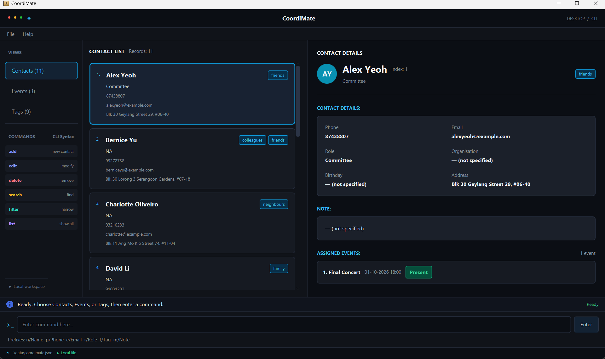

# CoordiMate User Guide

**CoordiMate** is a desktop application that helps university CCA EXCO members organise committee information and coordinate their work. It lets users manage contacts and tags, plan events, assign members, and track attendance through a Command Line Interface (CLI) while retaining the benefits of a Graphical User Interface (GUI).

<!-- * Table of Contents -->
<page-nav-print />

--------------------------------------------------------------------------------------------------------------------

## Quick start

1. Ensure that Java `25` or later is installed on your computer.<br>
   **Mac users:** Ensure you have the precise JDK version prescribed [here](https://se-education.org/guides/tutorials/javaInstallationMac.html).

1. Download the latest `.jar` file from [here](https://github.com/AY2627S1-CS2103T-W12-3/tp/releases).

1. Copy the file to the folder you want to use as the _home folder_ for CoordiMate.

1. Open a terminal, `cd` to the folder containing the JAR file, and run `java -jar coordimate.jar`.<br>
   On the first launch, a maximized GUI similar to the one below should appear in a few seconds. Note how the app contains some sample data.<br>
   

   On subsequent launches, CoordiMate restores whether the window was maximized, together with its most recent
   non-maximized size and position. If those saved bounds do not fit the current display, such as after disconnecting
   a secondary screen or changing the display resolution, CoordiMate adjusts the window to remain fully visible.<br>

   The left sidebar switches between Contacts, Events, and Tags and shows commands for the selected view.
   Click a command name to put only the command word in the input and show its format and an example below the input.
   Complete the command by typing its arguments after the command word.
   The main workspace shows a list beside its details, and the command box, feedback, and prefix hints stay at the bottom.
   After a successful command, CoordiMate opens the view for its result: contact commands open Contacts, event
   commands open Events, and tag commands open Tags. `assign` and `unassign` keep the current view and refresh its
   related contact or event details. Failed commands keep the current view. A valid `delete` request opens Contacts
   when its confirmation prompt appears; Contacts remains open whether deletion is confirmed or cancelled. Successful
   `add` and `edit` commands select and reveal the affected contact. Confirmed deletion selects the contact now at the
   removed contact's position, or the previous contact if the removed contact was last. If the deleted contact was
   outside the displayed list, the current selection is retained.

1. Type a command in the command box and press Enter to execute it. For example, type **`help`** and press Enter to open the help window.<br>
   Press <kbd>Up</kbd> to recall earlier commands and <kbd>Down</kbd> to move toward the command you were typing.<br>
   To browse cards without reaching for the mouse, press <kbd>Esc</kbd> to enter Navigation mode, use
   <kbd>J</kbd>/<kbd>K</kbd> to move through the active view, <kbd>S</kbd> to switch views, then press <kbd>I</kbd>
   to return to Command mode.<br>
   Some example commands you can try:

   * `list` : Lists all contacts.

   * `add n/John Doe p/98765432 e/johnd@example.com r/Member` : Adds a contact named `John Doe` to CoordiMate.

   * `delete 3` : Asks to delete the 3rd contact shown in the current list. Type `y` and press Enter to confirm.

   * `clear` : Deletes all contacts, events, and custom tags.

   * `exit` : Exits the app.

   In the Contacts view, select a contact from the displayed list to see their phone number, email address,
   role, birthday, address, organisation, tags, note, and assigned events in the details pane. The number beside a contact is
   its index in the currently displayed list. If a list change hides the selected contact, the details pane clears.
   Unset optional fields show `— (not specified)`; a contact with no tags shows no tag chips.

1. Refer to the [Features](#features) section below for details of each command.

--------------------------------------------------------------------------------------------------------------------

## Features

Every command error is followed by the relevant command's description, `Parameters:`, and `Example:`.
Error messages shown below omit that usage text.
Conditions in the error tables assume the rest of the command is valid. If a command has several errors,
the first one encountered during validation is reported. Placeholders such as `{PREFIX}` and `{EVENT_NAME}`
are replaced with the actual parameter prefix, name, index, or other details.

| Condition | Error message |
|---|---|
| The input is empty or contains only whitespace. | `Invalid command format.` |
| The command word is unknown or uses the wrong capitalization. | `Unknown command. Use help to see the available commands. Example: help` |
| Existing data cannot be loaded before a command changes saved data. | `Saved data could not be loaded. Check the local data file.` |

For `dismiss`, data-loading and saving failures instead produce the session-only warning described in
[Dismissing a reminder](#dismissing-a-reminder-dismiss).

<box type="info" seamless>

**Notes about the command format:**<br>

* Words in `UPPER_CASE` are the parameters to be supplied by the user.<br>
  For example, in `add n/NAME`, replace `NAME` with a value such as `John Doe`.

* Items in square brackets are optional.<br>
  For example, `n/NAME [t/TAG]` can be used as `n/John Doe t/friend` or as `n/John Doe`.

* Items followed by `...` are repeatable and can appear zero or more times.<br>
  For example, `[t/TAG]...` may be omitted, or written as `t/friend` or `t/friend t/family`.

* Parameters can be in any order.<br>
  For example, if the command specifies `n/NAME p/PHONE_NUMBER`, `p/PHONE_NUMBER n/NAME` is also acceptable.

* Extraneous parameters for commands that take no parameters, such as `help`, `list`, `exit`, and `clear`, are ignored.<br>
  For example, `help 123` is interpreted as `help`.

* If you are using a PDF version of this document, be careful when copying and pasting commands that span multiple lines as space characters surrounding line-breaks may be omitted when copied over to the application.
</box>

### Parameter constraints

The table below lists the values each parameter accepts. Leading and trailing spaces are ignored for every parameter.
A command that breaks a constraint is rejected and makes no changes.

| Parameter | Prefix | Constraints |
|---|---|---|
| `NAME`, `MEMBER_NAME` | `n/`, `mem/` | 1 to 80 characters. Letters, spaces, hyphens (`-`), apostrophes (`'`), and periods (`.`) only, with at least one letter. Digits are not allowed. Contact names are unique, ignoring case. |
| `PHONE` | `p/` | 7 to 15 digits. May start with `+`, and may contain spaces, hyphens, and brackets. Unique among contacts once spaces, hyphens, and brackets are removed. |
| `EMAIL` | `e/` | `local-part@domain`. The local part uses letters, digits, and `_`, `%`, `+`, `-`, `.`; it cannot start or end with a period or contain two periods in a row. The domain is made of labels separated by periods; each label uses letters, digits, and hyphens and cannot start or end with a hyphen. The last label has at least 2 letters. Unique among contacts, ignoring case. |
| `ROLE` | `r/` | 1 to 50 characters. Letters, digits, spaces, hyphens, and `/` only, with at least one letter or digit. |
| `BIRTHDAY` | `b/` | A real date in `dd-MM-yyyy` format that is not in the future, e.g. `18-06-2004`. |
| `ADDRESS` | `a/` | 1 to 200 characters. Any printable characters. |
| `ORGANISATION` | `o/` | 1 to 80 characters. Letters, digits, spaces, hyphens, and `&` only, with at least one letter or digit. |
| `NOTE` | `m/` | 1 to 500 characters. Any printable characters. |
| `TAG`, `NEW_TAG` | `t/`, `at/`, `rt/` | 1 to 30 characters. English letters and digits only, with no spaces. Tags are unique, ignoring case. |
| `EVENT_NAME`, `NEW_EVENT_NAME` | `evn/`, `nevn/` | At least one non-space character. Any characters are allowed, subject to the note below. Event names are unique, ignoring case. |
| `START_TIME`, `END_TIME` | `st/`, `et/` | A real date in `dd-MM-yyyy` format, optionally followed by a 24-hour time in `HH:mm` format, e.g. `17-09-2026` or `17-09-2026 16:30`. The start must not be after the end. |
| `STATUS` | `att/` | `present` or `absent`, ignoring case. |
| `INDEX`, `CONTACT_INDEX` | `c/` for `CONTACT_INDEX` | A positive integer (1, 2, 3, ...) that appears in the displayed contact list. |
| `KEYWORD` | none | At least one non-space character. |

<box type="info" seamless>

**Note:** In commands that accept multiple prefixed parameters, such as `add` and `addevent`, text within
a value that looks like another parameter—a space followed by letters and `/`—is read as the start of
another parameter.
For example, `addevent evn/Planning tag/review ...` is rejected with an unknown-parameter error, and in
`m/Check a/v setup` the text after `a/` is read as the address. Write such text without the space before it,
or without the `/`, e.g. `m/Check AV setup`.

Commands parse their arguments differently. For example, `search` treats the entire remainder as its keyword,
while tag commands tokenize only their recognised `t/` prefix.
</box>

### Navigating cards with the keyboard

CoordiMate starts in **Command mode**, with the command box ready for input. The mode indicator below the command box
shows the current mode and its available shortcuts.

Use the following keys to browse Contacts, Events, or Tags without the mouse:

| Key | Result |
|---|---|
| <kbd>Esc</kbd> | Enter **Navigation mode** from Command mode. |
| <kbd>J</kbd> | Select the next card in the active view. If nothing is selected, select the first card. |
| <kbd>K</kbd> | Select the previous card in the active view. If nothing is selected, select the last card. |
| <kbd>S</kbd> | Switch to the next view, wrapping from Tags back to Contacts. |
| <kbd>I</kbd> | Return to **Command mode** and focus the command box. |

Navigation stops at the first or last card rather than wrapping around. On an empty list, <kbd>J</kbd> and <kbd>K</kbd>
do nothing. The shortcuts apply to whichever of the Contacts, Events, or Tags views is active. Each view keeps its
selection when you switch away and back.

Other unmodified keys, including <kbd>Enter</kbd>, <kbd>Space</kbd>, <kbd>Tab</kbd>, and the arrow keys, are disabled
in Navigation mode. Pressing <kbd>Esc</kbd> moves keyboard focus away from controls such as a reminder's
**Dismiss** button, so those controls cannot be activated accidentally. Mouse controls remain available.

You can chain navigation and command entry without clicking. For example, press <kbd>Esc</kbd>, <kbd>J</kbd>,
<kbd>J</kbd>, <kbd>I</kbd>, then type a command. Any unfinished command remains in the command box while you navigate.

Clicking the command box or choosing a command from the left sidebar enters Command mode. Clicking the contact,
event, or tag list enters Navigation mode. Mode switching is disabled while CoordiMate is waiting for confirmation
of a delete command, so your confirmation input is not intercepted.

### Reusing commands with command history

With the command box focused, press <kbd>Up</kbd> to recall the most recently entered command. Keep pressing
<kbd>Up</kbd> to move through older commands, or press <kbd>Down</kbd> to move forward. Moving past the newest
command restores any unfinished text that was in the box before you started browsing. You can edit a recalled
command; it runs only when you press Enter or select **Enter**.

History includes commands that produced errors, so you can correct and retry them. There is no fixed maximum number
of entries; the practical limit is the memory available to the app. History clears when you close CoordiMate.
Blank inputs and responses to a delete confirmation are not stored. History navigation is paused while CoordiMate
is waiting for a delete confirmation.

### Viewing help: `help`

Opens a resizable Help window containing a keyboard-navigation summary and a scrollable two-column table of every
available command and its usage format.
The [User Guide website](https://ay2627s1-cs2103t-w12-3.github.io/tp/) and **Copy URL** button remain at the bottom of
the window for access to detailed instructions.
Select **Close** or press <kbd>Esc</kbd> to dismiss the Help window without exiting CoordiMate.
Selecting **Help** in the top bar opens this window directly. Press <kbd>Fn</kbd> + <kbd>F1</kbd> to open it with the
keyboard. In the command formats, parameters enclosed in square brackets `[ ]` are optional.

Format: `help`


### Adding a contact: `add`

Adds a contact to CoordiMate.

Contact names must be unique after trimming surrounding spaces and ignoring case.
An add is also rejected if its phone number or email address is already used by another contact.
Phone numbers are compared without spaces, hyphens, or brackets; email addresses are compared without regard to case.
For any duplicate, CoordiMate reports `A contact with this name, phone number, or email already exists.`
and makes no changes.
If the local contact data cannot be loaded or saved, CoordiMate reports an error and leaves the contact list unchanged.

Format: `add n/NAME p/PHONE e/EMAIL r/ROLE [b/BIRTHDAY] [a/ADDRESS] [o/ORGANISATION] [t/TAG]... [m/NOTE]`

Name, phone, email, and role are required. Each field accepts the following values; surrounding spaces are ignored:

| Field | Constraints |
|---|---|
| `NAME` | 1 to 80 characters: letters, spaces, hyphens (`-`), apostrophes (`'`), and periods (`.`), with at least one letter. |
| `PHONE` | 7 to 15 digits, optionally starting with `+`, with optional spaces, hyphens, and brackets. |
| `EMAIL` | `local-part@domain`, at most 254 characters, with a local part of at most 64 characters. |
| `ROLE` | 1 to 50 characters: letters, digits, spaces, hyphens, and slashes (`/`), with at least one letter or digit. |
| `BIRTHDAY` | A real date in `dd-MM-yyyy` format that is not in the future. |
| `ADDRESS` | 1 to 200 printable characters. |
| `ORGANISATION` | 1 to 80 characters: letters, digits, spaces, and `-` `&` `.` `,` `'` `(` `)` `/`, with at least one letter or digit, e.g. `St. John's Ambulance`. |
| `NOTE` | 1 to 500 printable characters. |
| `TAG` | 1 to 30 letters or digits with no spaces. |

"Printable" excludes line breaks and other control characters. A value that breaks these rules is rejected with a
message stating the field's constraints, such as
`Invalid organisation. Use 1 to 80 characters: letters, digits, spaces, and - & . , ' ( ) /, with at least one letter or digit. Example: o/NUS Student Affairs`.
Address, organisation, and note are optional. An empty `b/`, `a/`, `o/`, or `m/` leaves that field unset,
as does omitting it. Non-tag fields may appear only once; `t/TAG` may repeat. An empty `t/` clears the
tags collected so far. A valid new tag is saved as a custom tag. Successful feedback is
`Contact saved successfully: NAME`.
After a successful `add`, CoordiMate selects and reveals the new contact so its details are shown. Unset optional
values are shown as `— (not specified)` in the details pane, but remain unset in storage.

<box type="tip" seamless>

**Tip:** A contact can have any number of tags, including zero. Parameters can be supplied in any order.
</box>

Examples:
* `add n/Aisha Tan p/+6591234567 e/aisha@example.com r/Logistics t/EXCO m/Handles venue bookings`
* `add n/Mr Lim p/90801110 e/lim@example.com o/NUS Student Affairs r/University Staff t/UniversityStaff`

| Condition | Error message |
|---|---|
| Any required prefix (`n/`, `p/`, `e/`, or `r/`) is missing, or there is text before the first parameter. | `Invalid command format.` |
| A non-tag parameter is repeated. | `Parameter {PREFIX} may only be specified once.` |
| An unknown parameter is used. | `Unknown parameter: {PREFIX}.` |
| The name is empty or contains only whitespace. | `Name must not be empty. Example: n/Aisha Tan` |
| The phone number is empty or contains only whitespace. | `Phone number must not be empty. Example: p/+6591234567` |
| The email is empty or contains only whitespace. | `Email must not be empty. Example: e/aish@example.com` |
| The role is empty or contains only whitespace. | `Role must not be empty. Example: r/Logistics Lead` |
| The name violates its constraints. | `Invalid name. Use 1 to 80 characters: letters, spaces, hyphens, apostrophes, and periods, with at least one letter. Example: n/Aisha Tan` |
| The phone number violates its constraints. | `Invalid phone number. Use 7 to 15 digits, optionally starting with +, with optional spaces, hyphens, and brackets. Example: p/+6591234567` |
| The email violates its constraints. | `Invalid email. Use local-part@domain, at most 254 characters, with a local part of at most 64 characters. Example: e/aish@example.com` |
| The role violates its constraints. | `Invalid role. Use 1 to 50 characters: letters, digits, spaces, hyphens, and slashes, with at least one letter or digit. Example: r/Logistics Lead` |
| A non-empty birthday is invalid, incorrectly formatted, or in the future. | `Invalid birthday. Use a real date in dd-MM-yyyy format that is not in the future. Example: b/18-06-2004` |
| A non-empty address exceeds 200 characters or contains a control character. | `Invalid address. Use 1 to 200 printable characters. Example: a/21 Kent Ridge Road, #03-12` |
| A non-empty organisation violates its constraints. | `Invalid organisation. Use 1 to 80 characters: letters, digits, spaces, and - & . , ' ( ) /, with at least one letter or digit. Example: o/NUS Student Affairs` |
| A non-empty note exceeds 500 characters or contains a control character. | `Invalid note. Use 1 to 500 printable characters. Example: m/Handles venue bookings` |
| A non-empty tag contains spaces, symbols, or punctuation. | `Invalid tag name. Use letters and numbers without spaces. Example: t/Publicity` |
| A tag exceeds 30 characters. | `Tag name must not exceed 30 characters. Example: t/Publicity` |
| Another contact has the same name, phone number, or email. | `A contact with this name, phone number, or email already exists.` |

If saving fails, the command reports `Contact could not be saved. No changes were made.`

### Adding an event: `addevent`

Creates an event and saves it to the local data file.

Format: `addevent evn/EVENT_NAME st/START_TIME et/END_TIME`

Each parameter must appear once. Leading and trailing whitespace is removed before an event name is checked.
The resulting name must contain 1 to 100 printable characters; line breaks and other control characters within
the name are rejected. Names must be unique, ignoring case.
An overlong name reports `Event name must not exceed 100 characters. Example: evn/Final Concert`.
An invalid character reports `Invalid event name. Use letters, digits, spaces, or punctuation. Example: evn/Final-Concert`.
Different events may share the same start and end times.

Start and end times use `dd-MM-yyyy`, optionally followed by `HH:mm` in 24-hour format.
Date-only values are saved without a time of day.

The start must not be after the end. Equal start and end values are allowed.
Dates are compared first. On the same date, times are compared only when both are
specified.

Examples:

* `addevent evn/Final Concert st/08-08-2026 15:00 et/08-08-2026 18:00`
* `addevent evn/Student Life Fair st/09-10-2026 et/10-10-2026`

Success: `Created Event Student Life Fair. Start Time: 09-10-2026. End Time: 10-10-2026.`

Use the **Events** tab on the left to browse saved events. Selecting an event shows its
start time, end time, duration, and members. Each member row shows the contact's role,
organisation, tags, notes, and attendance status. A successful `addevent` opens this tab and selects
the new event. Each event card shows its member count and attendance summary. At narrower window
sizes, the list appears above the details. The list and details divider can be dragged, but the
details pane keeps a minimum width while the panes are side by side.

Command feedback appears above the input at the bottom of the window. Rejected commands
show a red feedback band and input border. The command stays in the input so you can
correct it, then press Enter or click **Retry**.

| Condition | Error message |
|---|---|
| An event with the same name already exists, ignoring case. | `An event with this name already exists. No changes were made.` |
| The event name is empty. | `Event name must not be empty. Example: evn/Final Concert` |
| All required parameters are present, but `st/` contains only whitespace. | `Start time must not be empty. Example: st/17-09-2026 16:30` |
| All required parameters are present, but `et/` contains only whitespace. | `End time must not be empty. Example: et/17-09-2026 18:30` |
| A time is invalid or incorrectly formatted. | `Invalid event time. Use dd-MM-yyyy with an optional time in HH:mm format. Example: st/17-09-2026 16:30` |
| The start is after the end. | `Start time must not be after end time. Example: st/17-09-2026 16:30 et/17-09-2026 18:30` |
| Any required parameter (`evn/`, `st/`, or `et/`) is missing, or there is text before the first parameter. | `Invalid command format.` |
| A parameter is repeated. | `Parameter {PREFIX} may only be specified once.` |
| An unknown parameter is used. | `Unknown parameter: {PREFIX}.` |

If saving fails, no event is added and the command reports `Event could not be saved. No changes were made.`
If the existing data file is invalid, the command reports a load error and leaves the file untouched.

### Editing an event: `editevent`

Edits the name, start time, and/or end time of an existing event and saves the changes.

Format: `editevent evn/EVENT_NAME [nevn/NEW_EVENT_NAME] [st/NEW_START_TIME] [et/NEW_END_TIME]`

`EVENT_NAME` must match the saved name, ignoring case. Leading and trailing whitespace
is removed. Lookup capitalization does not change the saved display name; `nevn/`
sets the new display name using the supplied capitalization.
Provide at least one field to edit; omitted fields
keep their existing values. Each parameter may appear only once.

The new name follows the same rules as in `addevent`: 1 to 100 printable characters, not duplicating
another event's name, ignoring case. Start and end times use `dd-MM-yyyy [HH:mm]`; a date is
required and a 24-hour time is optional. The updated start must not be after the
updated end, using the same ordering rules as `addevent`.

Examples:

* `editevent evn/Final Concert st/08-08-2026 16:00 et/08-08-2026 19:00`
* `editevent evn/Student Life Fair nevn/NUS Student Life Fair et/10-10-2026`
* `editevent evn/CCA MEETING nevn/CCA MEETING` changes the display name of `CCA Meeting` to `CCA MEETING`.

Success: `Edited Event NUS Student Life Fair. Start Time: 09-10-2026. End Time: 10-10-2026.`

| Condition | Error message |
|---|---|
| `evn/` is missing, or there is text before the first parameter. | `Invalid command format.` |
| No saved event has the supplied name, ignoring case. | `Event {EVENT_NAME} does not exist. Use a saved event name.` |
| The event name is empty or contains only whitespace. | `Event name must not be empty. Example: evn/Final Concert` |
| The new event name is empty or contains only whitespace. | `New event name must not be empty. Example: nevn/Final Concert` |
| The event name is longer than 100 characters. | `Event name must not exceed 100 characters. Example: evn/Final Concert` |
| The new event name is longer than 100 characters. | `Event name must not exceed 100 characters. Example: nevn/Final Concert` |
| The event name contains a line break or other control character. | `Invalid event name. Use letters, digits, spaces, or punctuation. Example: evn/Final-Concert` |
| The new event name contains a line break or other control character. | `Invalid event name. Use letters, digits, spaces, or punctuation. Example: nevn/Final-Concert` |
| `st/` is supplied, but its value is empty or contains only whitespace. | `Start time must not be empty. Example: st/17-09-2026 16:30` |
| `et/` is supplied, but its value is empty or contains only whitespace. | `End time must not be empty. Example: et/17-09-2026 18:30` |
| The new start time is invalid or incorrectly formatted. | `Invalid event time. Use dd-MM-yyyy with an optional time in HH:mm format. Example: st/17-09-2026 16:30` |
| The new end time is invalid or incorrectly formatted. | `Invalid event time. Use dd-MM-yyyy with an optional time in HH:mm format. Example: et/17-09-2026 16:30` |
| The new name duplicates another event. | `This update conflicts with another saved event. No changes were made.` |
| `evn/` has a valid name, but none of `nevn/`, `st/`, or `et/` is supplied. | `Provide at least one field to edit.` |
| A parameter is repeated. | `Parameter {PREFIX} may only be specified once.` |
| An unknown parameter is used. | `Unknown parameter: {PREFIX}.` |
| The updated start is after the updated end. | `Start time must not be after end time. Example: st/17-09-2026 16:30 et/17-09-2026 18:30` |

If saving fails, the command reports `Event could not be saved. No changes were made.`
The event and existing data file remain unchanged.

### Deleting an event: `deleteevent`

Deletes the event with the supplied name, ignoring capitalization. Internal spacing
must match the existing event name.

Format: `deleteevent evn/EVENT_NAME`

Examples:

* `deleteevent evn/Final Concert`
* `deleteevent evn/Student Life Fair`

Success: `Deleted Event Final Concert.`

| Condition | Error message |
|---|---|
| `evn/` is missing, or there is text before `evn/`. | `Invalid command format.` |
| The event name is empty or contains only whitespace. | `Event name must not be empty. Example: evn/Final Concert` |
| No saved event has the supplied name, ignoring case. | `Event {EVENT_NAME} does not exist. Use a saved event name.` |
| The event name is longer than 100 characters. | `Event name must not exceed 100 characters. Example: evn/Final Concert` |
| The event name contains a line break or other control character. | `Invalid event name. Use letters, digits, spaces, or punctuation. Example: evn/Final-Concert` |
| `evn/` is repeated. | `Parameter evn/ may only be specified once.` |
| An unknown parameter is used. | `Unknown parameter: {PREFIX}.` |

If saving fails, the command reports `Event could not be deleted. No changes were made.`
The event and existing data file remain unchanged.

### Automatic event reminders

CoordiMate shows reminders in the **Upcoming events** panel below the menu bar and above the workspace.
The panel appears when reminders are available and stays visible across the **Contacts**, **Events**, and
**Tags** views. It hides when no reminders remain. No command is needed to receive reminders, which appear
only while CoordiMate is running.

CoordiMate checks saved events on startup and once per minute while the window is open. It also refreshes
reminders after commands, including event edits and deletions. A reminder becoming eligible or expiring
as time passes updates at the next periodic check.

Reminder timing follows your computer's local time zone:

* For a start with a time of day, the reminder becomes eligible exactly **24 hours before the start**.
  It remains eligible at the exact start time. Once the start has passed, the next check removes it,
  even if the event has not ended.
* For a start with only a date, the reminder is eligible throughout **the preceding calendar day and
  the event's start date**. For example, a start of `20-10-2026` qualifies from midnight at the beginning
  of `19-10-2026` until midnight at the beginning of `21-10-2026`, excluding that final midnight.

Each reminder displays its index and the saved event name, start, and end. For example:

```text
1. Upcoming event: Final Concert
Starts: 20-10-2026 15:00
Ends: 20-10-2026 18:00
```

This timed event qualifies from `19-10-2026 15:00` through `20-10-2026 15:00`, including both boundaries.
Several reminders appear in ascending order of start time, with ties ordered by name, ignoring case.
For ordering, a date-only start counts as the beginning of its date; the reminder still displays the
saved date without adding a time. Each event has at most one active reminder.
Indexes start at **1** and follow this order. They update whenever the reminder list changes.

Click **Dismiss** beside a reminder or use [`dismiss INDEX`](#dismissing-a-reminder-dismiss) to hide it.
CoordiMate saves the dismissal immediately, so it stays
dismissed after restarting. Renaming the event, editing only its end, or supplying the same start value
keeps the dismissal. Changing its start date or time resets the dismissal, including when switching
between a timed and date-only start or reverting to a previously dismissed start. The revised reminder
appears if its new start qualifies under the timing rules above. Rejected or unsaved edits leave reminders
unchanged.

Deleting an event removes its reminder. The `clear` command removes all events and their reminders.
Deleting and then recreating an event creates a new reminder if its start qualifies, even when the name
and schedule match the deleted event.

If CoordiMate cannot save a dismissal, it hides the reminder for the current session and shows
`Reminder dismissal could not be saved and may reappear after restarting.` with a **Not saved** status
in the feedback area above the command input. The dismissal has not been saved, so the reminder may
return after restarting.

If the saved data file is invalid, CoordiMate starts with an empty dataset and shows no event reminders.
See [Editing the data file](#editing-the-data-file) for details of data-loading errors.

### Dismissing a reminder: `dismiss`

Dismisses one reminder using its current index in the **Upcoming events** panel and saves the dismissal.
The event, its members, and its attendance records remain available. The current tab and contact filter
stay selected.

Format: `dismiss INDEX`

* `INDEX` is required and must be a positive integer starting at **1**.
* Use the index shown beside the reminder in the **Upcoming events** panel. The contact and event lists
  have their own ordering.
* Remaining reminders are renumbered after dismissal. Use their current indexes for subsequent commands.

Examples:

* `dismiss 1` dismisses the first reminder in the panel.
* `dismiss 2` dismisses the second reminder, if at least two reminders are shown.

Success: `Reminder dismissed: {EVENT_NAME}.` The reminder disappears immediately and stays dismissed after
restarting. Changing the event's start resets its dismissal as described in
[Automatic event reminders](#automatic-event-reminders).

| Condition | Error message |
|---|---|
| The index is missing. | `Invalid command format.` |
| The index is zero, negative, non-integer, greater than 2147483647, or followed by extra arguments. | `Index must be a positive integer. Example: 1` |
| No reminder has that index, including when the panel is empty. | `No reminder exists at index {INDEX}. Use an index from the Upcoming events panel.` |
| The reminder at that index is no longer upcoming (for example, its event has started) because the panel had not yet updated. | `Reminder {INDEX} is no longer upcoming, so it was not dismissed. Check the updated Upcoming events panel.` |

Invalid input dismisses no reminder. If loading or saving the data file fails, the reminder is hidden for
the current session and feedback shows `Reminder dismissal could not be saved and may reappear after restarting.`
with a **Not saved** status. The saved dismissal history remains unchanged, so the reminder may return after
restarting. This is the same behavior as the **Dismiss** button.

### Assigning members to an event: `assign`

Assigns one or more contacts to an existing event as members and saves the change.

Format: `assign evn/EVENT_NAME c/CONTACT_INDEX [MORE_CONTACT_INDEXES]...`

* `EVENT_NAME` must match a saved event name, ignoring case. Leading and trailing whitespace is removed.
* `CONTACT_INDEX` refers to the index number shown in the displayed contact list. If the list is filtered (e.g. after `search`), the index refers to the filtered list. Use `list` to show everyone again. Separate several indexes with spaces. Each index **must be a positive integer starting at 1**.
* Each parameter may appear only once.
* All indexes are checked before any change is made. If any index is invalid, no contacts are assigned.
* Contacts who are already assigned to the event are skipped, and an index repeated in the same command is counted once.
* New members are added after the existing members, in the order given.

Selecting the event in the **Events** tab shows its members under **Members**.

Examples:

* `assign evn/Final Concert c/2` assigns the 2nd contact in the displayed list to `Final Concert`.
* `assign evn/student life fair c/1 4 5` assigns the 1st, 4th and 5th contacts to `Student Life Fair`.
* `search Bernice` followed by `assign evn/Final Concert c/1` assigns the 1st contact in the results of the `search` command.

Success: `Assigned 2 member(s) to Final Concert.`

If some contacts were already assigned: `Assigned 1 member(s) to Final Concert. 1 contact(s) were already assigned.`

| Condition | Error message |
|---|---|
| No saved event has the supplied name, ignoring case. | `Event {EVENT_NAME} does not exist. Use a saved event name.` |
| An index is larger than the displayed contact list. | `No contact exists at index {CONTACT_INDEX}. Use an index from the current contact list.` |
| An index is not written as digits representing a value from 1 to 2147483647. | `Contact indexes must be positive integers separated by spaces. Example: c/1 3 5` |
| Every specified contact is already assigned. | `All specified contacts are already assigned to {EVENT_NAME}. No changes were made.` |
| The event name is empty. | `Event name must not be empty. Example: evn/Final Concert` |
| The event name is longer than 100 characters. | `Event name must not exceed 100 characters. Example: evn/Final Concert` |
| The event name contains a line break or other control character. | `Invalid event name. Use letters, digits, spaces, or punctuation. Example: evn/Final-Concert` |
| `c/` has no indexes. | `Contact indexes must not be empty. Example: c/1 3 5` |
| `evn/` or `c/` is missing, or there is text before the first parameter. | `Invalid command format.` |
| A parameter is repeated. | `Parameter {PREFIX} may only be specified once.` |
| An unknown parameter is used. | `Unknown parameter: {PREFIX}.` |

If saving fails, the command reports `Assignment could not be saved. No changes were made.`
No contacts are assigned and the existing data file remains unchanged.

### Removing members from an event: `unassign`

Removes one or more members from an existing event and saves the change. The contacts themselves are not deleted.

Format: `unassign evn/EVENT_NAME c/CONTACT_INDEX [MORE_CONTACT_INDEXES]...`

* `EVENT_NAME` must match a saved event name, ignoring case. Leading and trailing whitespace is removed.
* `CONTACT_INDEX` refers to the index number shown in the displayed contact list, as in `assign`. If the list is filtered (e.g. after `search`), the index refers to the filtered list. Use `list` to show everyone again. Separate several indexes with spaces. Each index **must be a positive integer starting at 1**.
* Each parameter may appear only once.
* All indexes are checked before any change is made. If any index is invalid, no members are removed.
* Contacts who are not assigned to the event are skipped, and an index repeated in the same command is counted once.
* The remaining members keep their order.
* A removed member's attendance record for the event, if any, is also removed. Other members' attendance is kept.

Examples:

* `unassign evn/Final Concert c/2` removes the 2nd contact in the displayed list from `Final Concert`.
* `unassign evn/student life fair c/1 3` removes the 1st and 3rd contacts from `Student Life Fair`.
* `search Bernice` followed by `unassign evn/Final Concert c/1` removes the 1st contact in the results of the `search` command.

Success: `Removed 2 member(s) from Final Concert.`

If some contacts were not assigned: `Removed 1 member(s) from Final Concert. 1 contact(s) were not assigned.`

| Condition | Error message |
|---|---|
| No saved event has the supplied name, ignoring case. | `Event {EVENT_NAME} does not exist. Use a saved event name.` |
| An index is larger than the displayed contact list. | `No contact exists at index {CONTACT_INDEX}. Use an index from the current contact list.` |
| An index is not written as digits representing a value from 1 to 2147483647. | `Contact indexes must be positive integers separated by spaces. Example: c/1 3 5` |
| None of the specified contacts are assigned. | `None of the specified contacts are assigned to {EVENT_NAME}. No changes were made.` |
| The event name is empty. | `Event name must not be empty. Example: evn/Final Concert` |
| The event name is longer than 100 characters. | `Event name must not exceed 100 characters. Example: evn/Final Concert` |
| The event name contains a line break or other control character. | `Invalid event name. Use letters, digits, spaces, or punctuation. Example: evn/Final-Concert` |
| `c/` has no indexes. | `Contact indexes must not be empty. Example: c/1 3 5` |
| `evn/` or `c/` is missing, or there is text before the first parameter. | `Invalid command format.` |
| A parameter is repeated. | `Parameter {PREFIX} may only be specified once.` |
| An unknown parameter is used. | `Unknown parameter: {PREFIX}.` |

If saving fails, the command reports `Unassignment could not be saved. No changes were made.`
No members are removed and the existing data file remains unchanged.

### Viewing members of an event: `members`

Shows only the members of an event in the contact list, with their full contact details.

Format: `members evn/EVENT_NAME`

* `EVENT_NAME` must match a saved event name, ignoring case. Leading and trailing whitespace is removed.
* CoordiMate switches to the **Contacts** view and lists the event's members in contact list order.
* The members' index numbers can be used directly in other commands, such as `unassign`, `edit` and `delete`.
* The list stays up to date while it is shown: members removed with `unassign` disappear from it, and renaming the event with `editevent` keeps showing its members. If the event is deleted, the list becomes empty.
* `add` and `edit` show all contacts again afterwards, so that you can see the contact you changed.
* Use `list` to show all contacts again.

Selecting an event in the **Events** tab also shows its members under **Members**, in the order they were assigned. Each member shows **Present**, **Absent**, or **Not marked** if attendance has not been recorded. The counts above the list show how many members have each status. They update as soon as attendance is successfully marked or changed with `markattendance`.

Examples:

* `members evn/Final Concert` shows the members of `Final Concert`.
* `members evn/student life fair` shows the members of `Student Life Fair`.
* `members evn/Final Concert` followed by `unassign evn/Final Concert c/2` removes the 2nd member shown.

Success: `Listed 2 member(s) of Final Concert. Use list to show all contacts.`

If the event has no members, the contact list is empty: `Final Concert has no members assigned. Use list to show all contacts.`

| Condition | Error message |
|---|---|
| No saved event has the supplied name, ignoring case. | `Event {EVENT_NAME} does not exist. Use a saved event name.` |
| The event name is empty. | `Event name must not be empty. Example: evn/Final Concert` |
| The event name is longer than 100 characters. | `Event name must not exceed 100 characters. Example: evn/Final Concert` |
| The event name contains a line break or other control character. | `Invalid event name. Use letters, digits, spaces, or punctuation. Example: evn/Final-Concert` |
| `evn/` is missing, or there is text before it. | `Invalid command format.` |
| `evn/` is repeated. | `Parameter evn/ may only be specified once.` |
| An unknown parameter is used. | `Unknown parameter: {PREFIX}.` |

If an error occurs, the contact list stays as it was.

### Marking attendance: `markattendance`

Records whether a member assigned to an event was present or absent.

Format: `markattendance evn/EVENT_NAME mem/MEMBER_NAME att/STATUS`

* `EVENT_NAME` and `MEMBER_NAME` must match saved values, ignoring case.
* `MEMBER_NAME` must be assigned to the event.
* `MEMBER_NAME` must be at most 80 characters, contain at least one letter, and use only letters, spaces,
  hyphens, apostrophes, or periods.
* `STATUS` must be `present` or `absent`, ignoring case.
* Marking a member again replaces their previous attendance status.

Examples:

* `markattendance evn/Final Concert mem/Alex Yeoh att/present` marks Alex Yeoh as present.
* `markattendance evn/final concert mem/alex yeoh att/ABSENT` marks the same member as absent.

Success: `Marked Alex Yeoh as present for Event Final Concert.`

If the member already has the requested status, no changes are made:
`Alex Yeoh is already marked as present for event Final Concert. No changes were made.`

| Condition | Error message |
|---|---|
| No saved event has the supplied name, ignoring case. | `Event {EVENT_NAME} does not exist. Use a saved event name.` |
| The supplied member is not assigned to the event, ignoring case. | `{MEMBER_NAME} is not assigned to event {EVENT_NAME}. Assign the contact to the event before marking attendance.` |
| The member name violates the constraints above. | `Invalid name. Use 1 to 80 characters: letters, spaces, hyphens, apostrophes, and periods, with at least one letter. Example: mem/Aisha Tan` |
| `STATUS` is not `present` or `absent`, ignoring case. | `Invalid attendance status. Use present or absent. Example: att/present` |
| The event name is empty. | `Event name must not be empty. Example: evn/Final Concert` |
| The event name is longer than 100 characters. | `Event name must not exceed 100 characters. Example: evn/Final Concert` |
| The event name contains a line break or other control character. | `Invalid event name. Use letters, digits, spaces, or punctuation. Example: evn/Final-Concert` |
| Any required parameter (`evn/`, `mem/`, or `att/`) is missing, or there is text before the first parameter. | `Invalid command format.` |
| The member name is empty. | `Member name must not be empty. Example: mem/Aisha Tan` |
| The attendance status is empty. | `Attendance status must not be empty. Example: att/present` |
| A parameter is repeated. | `Parameter {PREFIX} may only be specified once.` |
| An unknown parameter is used. | `Unknown parameter: {PREFIX}.` |

Attendance is shown beside each member when the event is selected in the **Events** tab.
Removing a member with `unassign`, or deleting the contact, also removes that member's attendance for the event.
If saving fails, the attendance is not changed and the command reports
`Attendance could not be saved. No changes were made.`

### Listing all contacts: `list`

Shows a list of all contacts in CoordiMate, removing any search, filter, or members view.

Format: `list`

Success: `Listed all contacts.`

### Deleting a tag: `deletetag`

Deletes an existing tag, including a default tag, and removes it from every contact to which it is assigned.

Format: `deletetag t/TAG`

Examples:

* `deletetag t/ProductionCrew`
* `deletetag t/Publicity`

The tag name is matched case-insensitively.

Success: `{TAG_NAME} successfully deleted.`

| Condition | Error message |
|---|---|
| The `t/` prefix is missing, or there is text before it. | `Invalid command format.` |
| The tag name is empty. | `Tag name must not be empty. Example: t/Publicity` |
| More than one `t/` prefix is supplied. | `Parameter t/ may only be specified once.` |
| An unknown parameter is used. | `Unknown parameter: {PREFIX}.` |
| The specified tag does not exist. | `Tag {TAG_NAME} does not exist. Use a saved tag name.` |

If saving fails, the command reports `Tag could not be saved. No changes were made.`

### Editing a tag: `edittag`

Renames an existing tag, including a default tag, and updates it wherever it is applied across contacts.

Format: `edittag OLD_TAG t/NEW_TAG`

Examples:

* `edittag Production t/ProductionCrew`
* `edittag Media t/Publicity`

`OLD_TAG` must match an existing tag, ignoring capitalization. `NEW_TAG` must contain 1 to 30
alphanumeric characters without spaces. Leading and trailing whitespace is trimmed before validation.

Success for `edittag Media t/Publicity`: `Media successfully renamed to Publicity.`

| Condition | Error message |
|---|---|
| The current tag does not exist. | `Tag {OLD_TAG} does not exist. Use a saved tag name.` |
| The `t/` prefix is missing. | `Invalid command format.` |
| The current tag name is missing. | `Invalid command format.` |
| The new tag name is blank. | `Tag name must not be empty. Example: t/Publicity` |
| More than one `t/` prefix is supplied. | `Parameter t/ may only be specified once.` |
| An unknown parameter is used. | `Unknown parameter: {PREFIX}.` |
| The new tag contains spaces, symbols, or punctuation. | `Invalid tag name. Use letters and numbers without spaces. Example: t/Publicity` |
| The new tag exceeds 30 characters. | `Tag name must not exceed 30 characters. Example: t/Publicity` |
| The new tag matches the current tag, ignoring capitalization. | `Tag {OLD_TAG} already has that name. No changes were made.` |
| The new tag already exists. | `A tag with this name already exists. No changes were made.` |

If saving fails, the command reports `Tag could not be saved. No changes were made.`

### Adding a tag: `addtag`

Creates a custom tag and opens the Tags view. Tag names must contain 1 to 30 alphanumeric characters without spaces.
Leading and trailing whitespace is trimmed. Tag names preserve their capitalization, but are unique regardless of
capitalization.

Format: `addtag t/TAG`

Examples:

* `addtag t/ProductionCrew`
* `addtag t/Publicity`

If a tag named `Publicity` already exists, commands such as `addtag t/publicity` are rejected as duplicates.

Success: `Created tag: Publicity.`

| Condition | Error message |
|---|---|
| No parameters are supplied. | `Invalid command format.` |
| The `t/` prefix is missing. | `Invalid command format.` |
| More than one `t/` prefix is supplied. | `Parameter t/ may only be specified once.` |
| Text appears before `t/`. | `Invalid command format.` |
| An unknown parameter is used. | `Unknown parameter: {PREFIX}.` |
| The tag name is empty. | `Tag name must not be empty. Example: t/Publicity` |
| The tag name contains spaces, symbols, or punctuation. | `Invalid tag name. Use letters and numbers without spaces. Example: t/Publicity` |
| The tag name exceeds 30 characters. | `Tag name must not exceed 30 characters. Example: t/Publicity` |
| The tag name already exists, ignoring capitalization. | `A tag with this name already exists. No changes were made.` |

If saving fails, the command reports `Tag could not be saved. No changes were made.`

### Listing all tags: `listtags`

Shows every default and custom tag in the Tags view.

Format: `listtags`

Select a tag in the **Tags** tab to see the contacts assigned to it and the member count. The member list includes
all saved contacts, regardless of the current contact search or filter, and is ordered by name. Each member shows
their tags, role, and organisation. Every tag assigned to a contact is included in this global tag list, including
tags recovered from older saved data.
Success: `Here is the list of all existing tags.` followed by `Tags: ` and the tag names, separated by commas.

Unlike `list`, `listtags` does not ignore extra text: `listtags 123` is rejected with
`Invalid command format.`

### Editing a contact: `edit`

Edits an existing contact in CoordiMate.

Format: `edit INDEX [n/NAME] [p/PHONE] [e/EMAIL] [r/ROLE] [b/BIRTHDAY] [a/ADDRESS] [o/ORGANISATION] [m/NOTE] [t/TAG]... [at/TAG]... [rt/TAG]...`

Or: `edit target/IDENTIFIER [n/NAME] [p/PHONE] [e/EMAIL] [r/ROLE] [b/BIRTHDAY] [a/ADDRESS] [o/ORGANISATION] [m/NOTE] [t/TAG]... [at/TAG]... [rt/TAG]...`

* Edits the contact at the specified `INDEX`. The index refers to the index number shown in the displayed contact list. The index **must be a positive integer starting at 1**.
* Alternatively, `target/IDENTIFIER` finds an exact saved name, phone number, or email address across all contacts, including those hidden by the current search or filter. Names and emails ignore letter case; phone numbers ignore spaces, hyphens, and brackets. Supply either an index or `target/`, not both.
* If several contacts match an identifier, the command lists each match's name, phone, and email. An index appears only for a match in the current displayed list. Retry with a unique phone or email, or a displayed index.
* If no contact matches `target/`, or the index is outside the displayed list, the command reports an error.
* Provide at least one field or tag operation. Omitted fields retain their existing values.
* Name, phone, email, and role cannot be cleared. Use `b/`, `a/`, `o/`, or `m/` with no value to clear that optional field.
* Birthday uses `dd-MM-yyyy` and cannot be in the future. Edited values follow the same validation rules as `add`.
* Older saved digit-only phone numbers with at least 3 digits remain usable. An edit without `p/` keeps the existing
  number; a supplied `p/` value must follow the current 7–15-digit rule.
* Each non-tag field may be specified only once. Unknown parameters are rejected.
* `t/TAG` replaces all existing tags; repeat it to specify several replacement tags. `t/` with no value clears the tag set.
* `at/TAG` adds a tag without removing other tags, while `rt/TAG` removes only that tag from the contact. These may be repeated or mixed and are applied in command order. Neither may be mixed with `t/`.
* Tag matching ignores case. Adding an existing tag or removing an absent tag has no effect. A valid new tag named by `t/` or `at/` is saved as a custom tag. Empty `at/` and `rt/` values are invalid.
* If the contact's name changes, events they are assigned to show the new name.
* A new name already used by another contact, ignoring case and surrounding spaces, is rejected.
* An edit is saved to the local data file before it appears in the contact list. If the file cannot be read or written,
  the edit is not applied. A failed write reports `Contact could not be saved. No changes were made.`; invalid stored
  data reports `Saved data could not be loaded. Check the local data file.`
* On success, `edit` confirms the updated name, phone, email, and role. The selected contact's details pane shows its
  current optional fields and tags.

Successful feedback example:

```text
Contact updated successfully:
Name: Aisha Tan
Phone: +6598765432
Email: aisha@example.com
Role: President
```

Examples:
*  `edit 1 p/91234567 e/johndoe@example.com` Edits the phone number and email address of the 1st contact to be `91234567` and `johndoe@example.com` respectively.
*  `edit 2 n/Betsy Crower t/` Edits the name of the 2nd contact to be `Betsy Crower` and clears all existing tags.
*  `edit 3 r/Logistics Lead m/Handles venue bookings` Updates a role and note.
*  `edit 3 b/ a/ o/ m/` Clears the optional birthday, address, organisation, and note.
*  `edit target/alice@example.com r/Vice-President` Updates a contact even if the current list is filtered.
*  `edit 3 at/Sponsor rt/Logistics` Adds Sponsor, then removes Logistics without changing other tags.

Edited contact fields use the same validation error messages as [`add`](#adding-a-contact-add).
Empty optional fields (`b/`, `a/`, `o/`, `m/`, and `t/`) clear those values and are accepted.
Additional errors are listed below.

| Condition | Error message |
|---|---|
| No arguments are supplied. | `Invalid command format.` |
| `target/` is omitted and the index is missing, is not a positive integer, or exceeds the supported integer range. | `Invalid contact index. Example: edit 2 r/President` |
| A positive index is larger than the displayed contact list. | `No contact exists at index {INDEX}. Use an index from the current contact list.` |
| Text or an index appears before `target/`. | `Specify exactly one contact identifier.` |
| `target/` is empty or contains only whitespace. | `Contact identifier must not be empty. Example: target/aisha@example.com` |
| No saved contact matches `target/`. | `No contact matches that identifier. Use an exact saved name, phone number, or email address.` |
| Several contacts match `target/`. | `Multiple contacts match that identifier:`<br>matching contact details<br>`Use a displayed index, phone number, or email address to identify the contact.` |
| A valid identifier is supplied without any fields or tag operations to edit. | `Provide at least one field or tag operation to edit.` |
| A parameter other than `t/`, `at/`, or `rt/` is repeated. | `Parameter {PREFIX} may only be specified once.` |
| An unknown parameter is used. | `Unknown parameter: {PREFIX}.` |
| `t/` is combined with `at/` or `rt/`. | `Use either t/ to replace tags, or at/ and rt/ to add or remove them.` |
| `at/` is empty or contains only whitespace. | `Tag name must not be empty. Example: at/Publicity` |
| `rt/` is empty or contains only whitespace. | `Tag name must not be empty. Example: rt/Publicity` |
| An `at/` tag contains spaces, symbols, or punctuation. | `Invalid tag name. Use letters and numbers without spaces. Example: at/Publicity` |
| An `rt/` tag contains spaces, symbols, or punctuation. | `Invalid tag name. Use letters and numbers without spaces. Example: rt/Publicity` |
| An `at/` tag exceeds 30 characters. | `Tag name must not exceed 30 characters. Example: at/Publicity` |
| An `rt/` tag exceeds 30 characters. | `Tag name must not exceed 30 characters. Example: rt/Publicity` |
| The updated name, phone number, or email conflicts with another saved contact. | `This update conflicts with another saved contact. No changes were made.` |
| Renaming the contact would duplicate a member name in an event. | `Cannot rename this contact because an event already has a member with that name. No changes were made.` |

### Searching contacts: `search`

Lists contacts whose name, phone number, email, address, or organisation contains the given keyword or phrase.

Format: `search KEYWORD`

* Matching is case-insensitive across all five fields; for example, `hans` matches `Hans`.
* Partial words match; for example, `Han` matches `Hans`.
* The entire keyword is matched as one substring within a field. Spaces and word order matter:
  `search Hans Bo` matches `Hans Bo Yang`, but does not match `Bo Hans` or separate contacts named `Hans` and `Bo`.
* Surrounding quotation marks are optional: `search "Jurong West"` and `search Jurong West` give the same results.
* Leading and trailing spaces are ignored. An empty keyword is rejected.
* Search checks all saved contacts, including those hidden by the current search or filter.
* Results replace the displayed contact list. Use their displayed indexes in subsequent commands, or `list` to show everyone.
* If nothing matches, the displayed list is empty and a no-matches message is shown.

Examples:
* `search John` matches `John Doe` by name and `john@example.com` by email.
* `search 9123` matches a phone number containing `9123`, such as `91234567`.
* `search EXAMPLE.COM` matches email addresses containing `example.com`, regardless of case.
* `search jurong west` matches addresses containing `Jurong West`.
* `search student affairs` matches organisations containing `Student Affairs`, such as `NUS Student Affairs`.

Success: `1 contact(s) found matching "John".`

If nothing matches: `No contacts found matching "John".`

| Condition | Error message |
|---|---|
| The keyword is missing, contains only whitespace, or is empty after surrounding quotation marks are removed. | `Invalid command format.` |

To narrow contacts by an exact tag, event, or organisation instead, use [`filter`](#filtering-contacts-filter).

### Filtering contacts: `filter`

Lists the contacts that have a given tag, are members of a given event, or belong to a given organisation.

Format: `filter FIELD/VALUE [FIELD/VALUE]...`

* `FIELD` is `tag`, `event`, or `organisation`, ignoring case. These are full words, not the prefixes used by
  other commands; for example, use `tag/EXCO`, not `t/EXCO`.
* `VALUE` must match a saved value in full, ignoring case. Unlike `search`, partial values do not match:
  `filter organisation/NUS` does not match `NUS Student Affairs`.
  * `tag/VALUE` lists contacts that have the tag. The tag must be in the tag list shown by `listtags`.
  * `event/VALUE` lists the members of the event with that name.
  * `organisation/VALUE` lists contacts whose organisation is that value. At least one contact must have it.
* When several filters are given, a contact must match **all** of them.
* Filter checks all saved contacts, including those hidden by the current search or filter.
* Results replace the displayed contact list. Use their displayed indexes in subsequent commands, or `list` to show everyone.
* If a value does not exist, the command is rejected and the displayed list stays as it was.

**Quotation marks**

* A value may be wrapped in quotation marks, which are removed: `filter event/"Final Concert"` and
  `filter event/Final Concert` give the same results.
* Inside quotation marks, text that looks like another field is kept as part of the value:
  `filter event/"Planning tag/review"` is one filter for an event named `Planning tag/review`. Such a name can
  exist only in a data file edited by hand, because `addevent` and `editevent` do not accept it.
* A quotation mark with no closing quotation mark is kept as part of the value when no field follows it:
  `filter event/"Cali` matches an event named `"Cali`. A filter like this must be the last one in the command,
  e.g. `filter tag/EXCO event/"Cali`.
* A quotation mark with no closing quotation mark, followed by another field, is rejected because it is unclear
  where the value ends: `filter event/"Cali tag/EXCO`.

Examples:
* `filter tag/EXCO` lists contacts tagged `EXCO`.
* `filter event/Final Concert` lists the members of `Final Concert`.
* `filter organisation/nus student affairs` lists contacts whose organisation is `NUS Student Affairs`.
* `filter event/"Final Concert" tag/EXCO` lists members of `Final Concert` who are also tagged `EXCO`.

Success: `2 contact(s) found.`

If every value exists but no contact matches all the filters, the displayed list is empty:
`No contacts match the specified filters.`

| Condition | Error message |
|---|---|
| No saved tag, event, or organisation has the supplied value. | `No saved tag, event, or organisation matches that value. Use a value from the saved data.` |
| An alphabetic `FIELD/` prefix is not `tag/`, `event/`, or `organisation/`, ignoring case. | `Unknown parameter: {PREFIX}.` |
| No filter is given, the input does not start with a `FIELD/` prefix, or there is text before the first field. | `Invalid command format.` |
| `tag/` has no value, contains only whitespace, or has an empty quoted value. | `Filter value must not be empty. Example: tag/Publicity` |
| `event/` has no value, contains only whitespace, or has an empty quoted value. | `Filter value must not be empty. Example: event/Final Concert` |
| `organisation/` has no value, contains only whitespace, or has an empty quoted value. | `Filter value must not be empty. Example: organisation/NUS Student Affairs` |
| A quotation mark is not closed and another field follows it. | `Invalid command format.` |

### Deleting a contact: `delete`

Finds a saved contact and asks for confirmation before deleting it.

Formats: `delete INDEX` · `delete n/NAME` · `delete p/PHONE` · `delete e/EMAIL`

* Supply exactly one identifier. `INDEX` is a positive integer in the currently displayed contact list.
* Name matching is exact apart from letter case and surrounding spaces. Phone matching ignores spaces, hyphens, and
  brackets. Email matching ignores letter case and surrounding spaces. These identifiers search all saved contacts,
  including those hidden by a search or filter.
* CoordiMate shows the contact's name, phone, email, and role, followed by `Confirm deletion? [y/N]`. Type exactly `y`
  or `Y` to delete. `n`, `N`, Enter, or any other input cancels. A cancelling input is **not** run as a command; enter it
  again if that was your intention.
* A confirmed deletion removes the contact from all event member lists, including past events. The events and other
  contacts remain saved. A cancelled deletion makes no changes.
* A confirmed deletion is saved before it appears in the contact list. A corrupt data file or failed write leaves the
  contact and events unchanged and reports a contact load or save error.

Examples:
* `list` followed by `delete 2`, then `y`, deletes the 2nd displayed contact.
* `search Betsy` followed by `delete 1`, then `Y`, deletes the 1st contact in the results.
* `delete e/aisha@example.com`, then `y`, deletes that saved contact even if a filter hides it.

On confirmation, feedback is `Contact deleted successfully: NAME.` Missing, invalid, unknown, repeated, and
non-matching identifiers are rejected without opening a confirmation prompt.

| Condition | Error message |
|---|---|
| No identifier is supplied. | `Invalid command format.` |
| An unprefixed identifier is not a positive integer or exceeds the supported integer range. | `Invalid contact index. Example: delete 3` |
| A positive index is larger than the displayed contact list. | `No contact exists at index {INDEX}. Use an index from the current contact list.` |
| Different prefixed identifiers are combined, or text or an index appears before a prefixed identifier. | `Specify exactly one contact identifier. Example: delete n/Aisha Tan` |
| `n/` is empty or contains only whitespace. | `Contact identifier must not be empty. Example: n/Aisha Tan` |
| `p/` is empty or contains only whitespace. | `Contact identifier must not be empty. Example: p/+6591234567` |
| `e/` is empty or contains only whitespace. | `Contact identifier must not be empty. Example: e/aish@example.com` |
| A parameter is repeated. | `Parameter {PREFIX} may only be specified once.` |
| An unknown parameter is used. | `Unknown parameter: {PREFIX}.` |
| No saved contact matches the identifier. | `No contact matches that identifier. Use an exact saved name, phone number, or email address.` |
| Several contacts match the identifier. | `Multiple contacts match that identifier:`<br>matching contact details<br>`Use a displayed index, phone number, or email address to identify the contact.` |

Cancelling reports `Deletion cancelled. No changes were made.`
If saving a confirmed deletion fails, the command reports `Contact could not be saved. No changes were made.`

### Clearing all entries: `clear`

Deletes all contacts, events, and custom tags from CoordiMate. The default tags (`EXCO`, `Sponsor`,
`UniversityStaff`, and `Logistics`) are restored, including any that were renamed or deleted.

Format: `clear`

Success: `CoordiMate has been cleared!`

<box type="warning" seamless>

**Caution:** `clear` takes effect immediately, without asking for confirmation, and cannot be undone.
</box>

The cleared data is saved before the contact, event, and tag lists change. If the local data file cannot be read,
CoordiMate reports `Saved data could not be loaded. Check the local data file.` If saving fails, it reports
`CoordiMate could not be cleared. No changes were made.` In either case, the displayed data remains unchanged.

### Exiting the program: `exit`

Closes CoordiMate. Your data is already saved, so nothing is lost.

Format: `exit`

### Saving the data

CoordiMate automatically saves data after commands that change it. You do not need to save manually.

A command that changes your data is saved to the data file **before** the change appears in the app. If the data
cannot be saved, the command is rejected with an error such as `Event could not be saved. No changes were made.`
and both the app and the data file stay as they were, so what you see always matches what is saved.

Commands that do not change saved data also attempt to save after running. A save failure reports one of the
following messages; a command may already have changed the displayed view when this happens.

| Condition | Error message |
|---|---|
| Saving is denied by file permissions. | `Data could not be saved to {DETAILS}. Check write permissions for the file and its folder.` |
| Another file error prevents saving. | `Data could not be saved. Check the local data file. Details: {DETAILS}` |

`{DETAILS}` is supplied by the operating system and can include a file path or an explanation of the failure.

### Editing the data file

CoordiMate data is saved automatically as a JSON file `[JAR file location]/data/coordimate.json`. Advanced users are welcome to update data directly by editing that data file.

<box type="warning" seamless>

**Caution:**
If your changes make the data file invalid, CoordiMate starts with an empty dataset at the next run. While the file is invalid, commands that change data (such as `add`, `addevent`, and `clear`) are rejected with `Saved data could not be loaded. Check the local data file.` and leave the file untouched, so that you can close the app and fix it. Commands such as `list`, `search`, and `filter` save the data currently in the app, which **replaces the invalid file**. We therefore recommend backing up the file before editing it.<br>
Each name in an event's `members` list must exactly match the name of a saved contact, or the data file is invalid.<br>
If a contact uses a tag that is missing from the top-level `tags` list, CoordiMate adds it to the global tag list when
the file is loaded. Existing top-level tags, including unused tags, retain their saved order and capitalization.<br>
Furthermore, certain edits can cause CoordiMate to behave in unexpected ways (e.g., if a value entered is outside of the acceptable range). Therefore, edit the data file only if you are confident that you can update it correctly.
</box>

--------------------------------------------------------------------------------------------------------------------

## FAQ

**Q**: How do I transfer my data to another computer?<br>
**A**: Install the app on the other computer and overwrite the data file it creates with the data file from your previous CoordiMate home folder.

--------------------------------------------------------------------------------------------------------------------

## Known issues

1. **If you minimize the Help Window** and then run the `help` command (or use the `Help` menu, or press `Fn` + `F1`) again, the original Help Window will remain minimized, and no new Help Window will appear. The remedy is to manually restore the minimized Help Window.

--------------------------------------------------------------------------------------------------------------------

## Command summary

Action | Format, Examples
-------|------------------
**Add contact** | `add n/NAME p/PHONE e/EMAIL r/ROLE [b/BIRTHDAY] [a/ADDRESS] [o/ORGANISATION] [t/TAG]... [m/NOTE]`<br> e.g., `add n/James Ho p/22224444 e/jamesho@example.com r/Member t/EXCO`
**Edit contact** | `edit INDEX [n/NAME] [p/PHONE] [e/EMAIL] [r/ROLE] [b/BIRTHDAY] [a/ADDRESS] [o/ORGANISATION] [m/NOTE] [t/TAG]... [at/TAG]... [rt/TAG]...`<br> or `edit target/IDENTIFIER [n/NAME] [p/PHONE] [e/EMAIL] [r/ROLE] [b/BIRTHDAY] [a/ADDRESS] [o/ORGANISATION] [m/NOTE] [t/TAG]... [at/TAG]... [rt/TAG]...`<br> e.g., `edit 2 n/James Lee e/jameslee@example.com`
**Delete contact** | `delete INDEX` or `delete n/NAME`, `delete p/PHONE`, `delete e/EMAIL`; confirm with `y`<br> e.g., `delete 3`
**List contacts** | `list`
**Search** | `search KEYWORD`<br> e.g., `search James`, `search "Jurong West"`
**Filter** | `filter FIELD/VALUE [FIELD/VALUE]...`<br> e.g., `filter tag/EXCO`, `filter event/"Final Concert" tag/EXCO`
**Add event** | `addevent evn/EVENT_NAME st/START_TIME et/END_TIME`<br> e.g., `addevent evn/Final Concert st/08-08-2026 15:00 et/08-08-2026 18:00`
**Edit event** | `editevent evn/EVENT_NAME [nevn/NEW_EVENT_NAME] [st/NEW_START_TIME] [et/NEW_END_TIME]`<br> e.g., `editevent evn/Final Concert st/08-08-2026 16:00 et/08-08-2026 19:00`
**Delete event** | `deleteevent evn/EVENT_NAME`<br> e.g., `deleteevent evn/Final Concert`
**Dismiss reminder** | `dismiss INDEX` (index from the **Upcoming events** panel)<br> e.g., `dismiss 1`
**Assign** | `assign evn/EVENT_NAME c/CONTACT_INDEX [MORE_CONTACT_INDEXES]...`<br> e.g., `assign evn/Final Concert c/1 4 5`
**Unassign** | `unassign evn/EVENT_NAME c/CONTACT_INDEX [MORE_CONTACT_INDEXES]...`<br> e.g., `unassign evn/Final Concert c/2 3`
**Members** | `members evn/EVENT_NAME`<br> e.g., `members evn/Final Concert`
**Mark attendance** | `markattendance evn/EVENT_NAME mem/MEMBER_NAME att/STATUS`<br> e.g., `markattendance evn/Final Concert mem/Alex Yeoh att/present`
**Add tag** | `addtag t/TAG`<br> e.g., `addtag t/Publicity`
**Edit tag** | `edittag OLD_TAG t/NEW_TAG`<br> e.g., `edittag Media t/Publicity`
**Delete tag** | `deletetag t/TAG`<br> e.g., `deletetag t/Publicity`
**List tags** | `listtags`
**Clear** | `clear`
**Help** | `help`
**Exit** | `exit`
